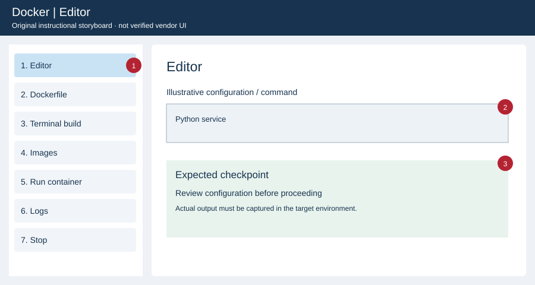
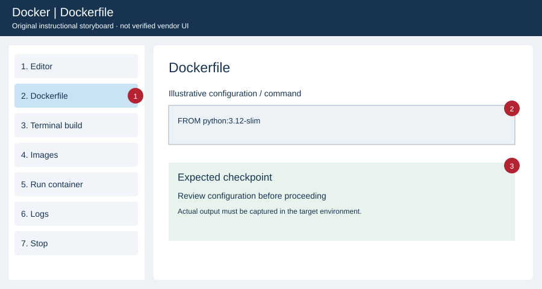
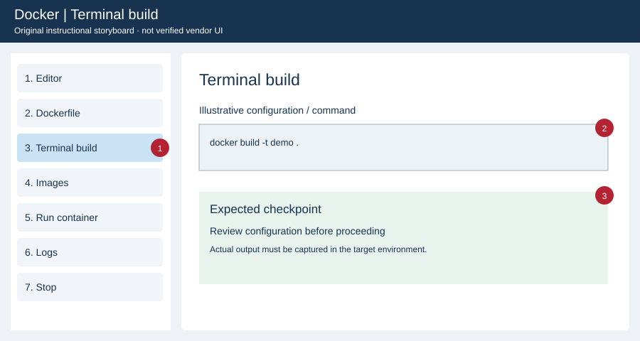
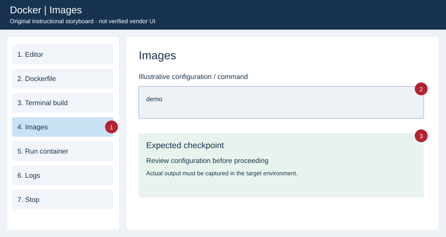
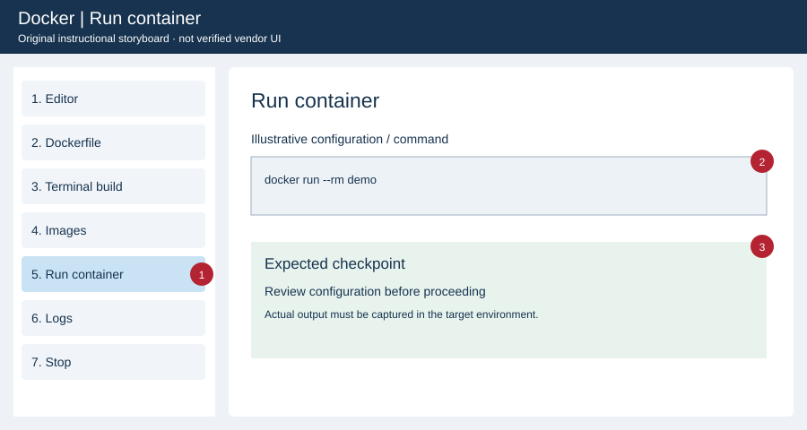
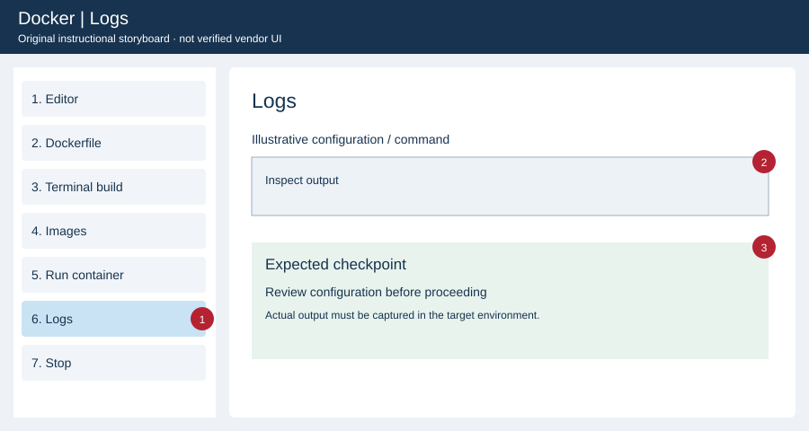
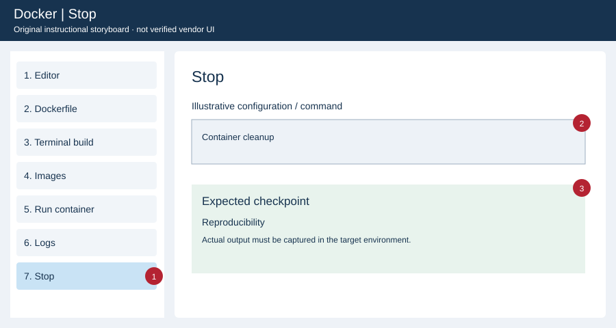

# Docker — numbered implementation walkthrough

Independent instructional storyboard. The navigation labels below are illustrative task stages, not verified vendor menu paths. No vendor deployment is claimed. Use synthetic data only. Prerequisites: browser for local illustrations; actual platform account, permissions and licensing must be established separately.

## Step 1: Editor
1. In the illustrated Docker workflow, locate callout 1 (Editor).
2. Inspect callout 2 and the sample value `Python service`.
3. Review the expected checkpoint at callout 3: configuration reviewed before continuing.
4. In the real environment, verify the equivalent control and capture actual output before proceeding.

## Step 2: Dockerfile
1. In the illustrated Docker workflow, locate callout 1 (Dockerfile).
2. Inspect callout 2 and the sample value `FROM python:3.12-slim`.
3. Review the expected checkpoint at callout 3: configuration reviewed before continuing.
4. In the real environment, verify the equivalent control and capture actual output before proceeding.

## Step 3: Terminal build
1. In the illustrated Docker workflow, locate callout 1 (Terminal build).
2. Inspect callout 2 and the sample value `docker build -t demo .`.
3. Review the expected checkpoint at callout 3: configuration reviewed before continuing.
4. In the real environment, verify the equivalent control and capture actual output before proceeding.

## Step 4: Images
1. In the illustrated Docker workflow, locate callout 1 (Images).
2. Inspect callout 2 and the sample value `demo`.
3. Review the expected checkpoint at callout 3: configuration reviewed before continuing.
4. In the real environment, verify the equivalent control and capture actual output before proceeding.

## Step 5: Run container
1. In the illustrated Docker workflow, locate callout 1 (Run container).
2. Inspect callout 2 and the sample value `docker run --rm demo`.
3. Review the expected checkpoint at callout 3: configuration reviewed before continuing.
4. In the real environment, verify the equivalent control and capture actual output before proceeding.

## Step 6: Logs
1. In the illustrated Docker workflow, locate callout 1 (Logs).
2. Inspect callout 2 and the sample value `Inspect output`.
3. Review the expected checkpoint at callout 3: configuration reviewed before continuing.
4. In the real environment, verify the equivalent control and capture actual output before proceeding.

## Step 7: Stop
1. In the illustrated Docker workflow, locate callout 1 (Stop).
2. Inspect callout 2 and the sample value `Container cleanup`.
3. Review the expected checkpoint at callout 3: Reproducibility.
4. In the real environment, verify the equivalent control and capture actual output before proceeding.

## Troubleshooting and executive acceptance
If a control is unavailable, verify role permissions, licensing and product version. If validation fails, stop, preserve the error and correct the input. Executive gate: Reproducibility. Record actual test output, reviewer and decision; do not claim completion without evidence.
