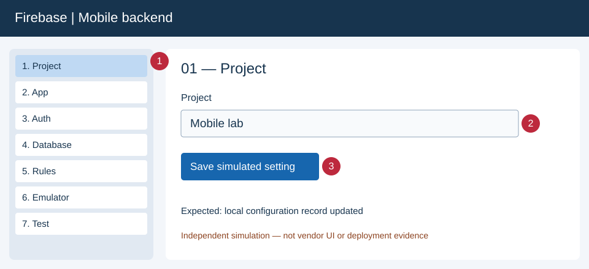
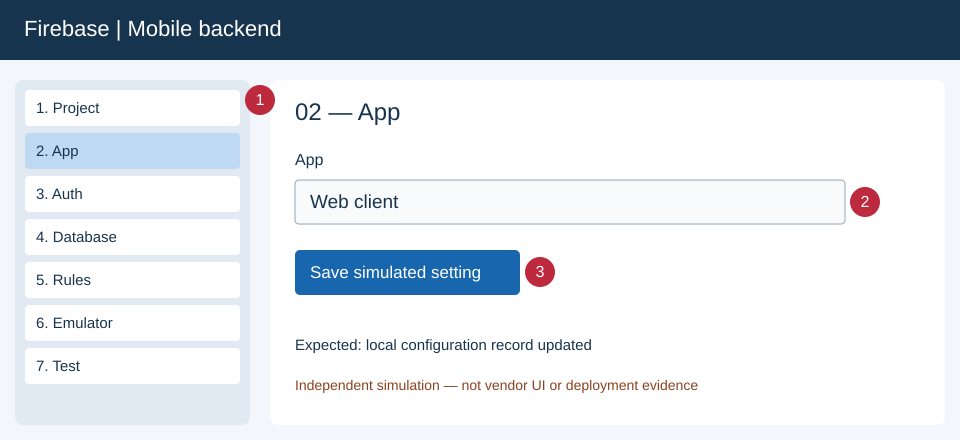
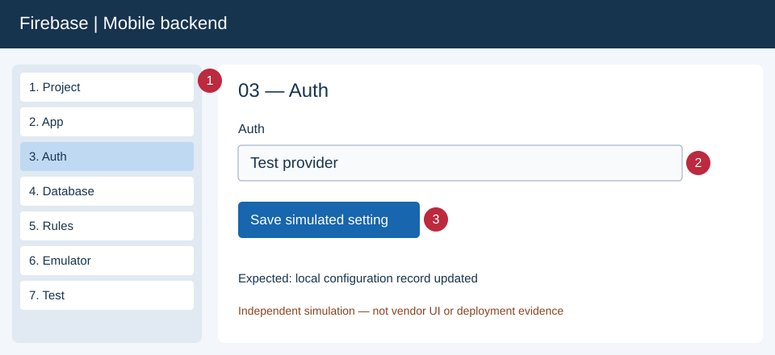
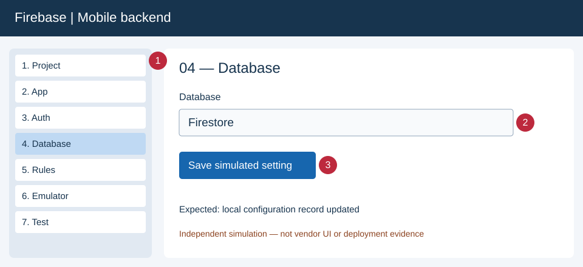
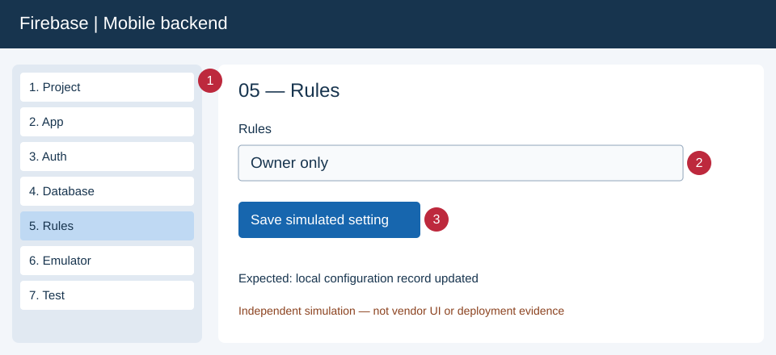
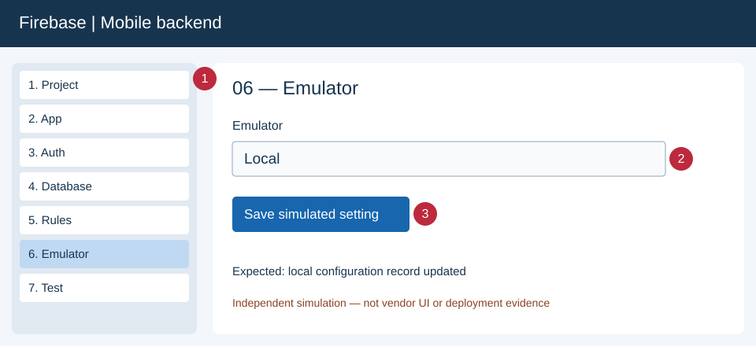
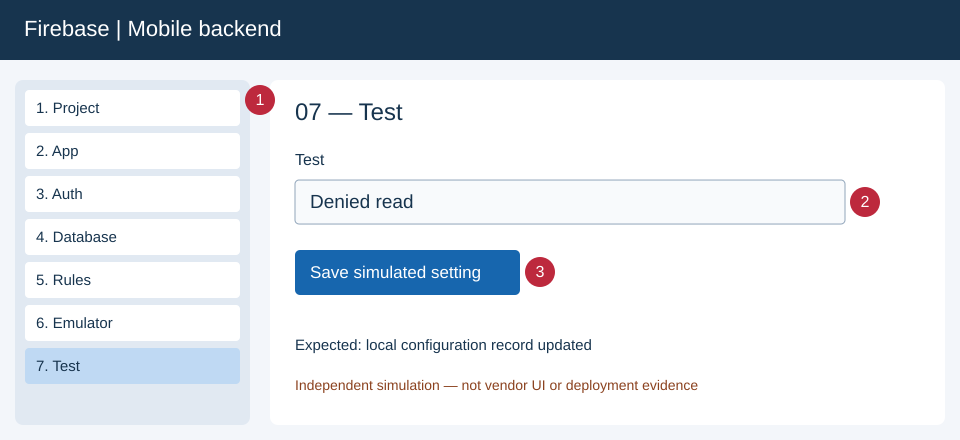

# Firebase — Mobile backend

Original interactive configuration simulation. Download index.html and open locally in a browser. GitHub file preview does not execute HTML. This is not a replica of the vendor interface; settings are illustrative and must be verified in a real sandbox.

[Interactive HTML source](index.html)

## 01 — Project

Select **Project** in the simulation navigation, enter `Mobile lab`, then select **Save simulated setting**. Confirm the configuration record contains the value before selecting Next step. This verifies local state only.

## 02 — App

Select **App** in the simulation navigation, enter `Web client`, then select **Save simulated setting**. Confirm the configuration record contains the value before selecting Next step. This verifies local state only.

## 03 — Auth

Select **Auth** in the simulation navigation, enter `Test provider`, then select **Save simulated setting**. Confirm the configuration record contains the value before selecting Next step. This verifies local state only.

## 04 — Database

Select **Database** in the simulation navigation, enter `Firestore`, then select **Save simulated setting**. Confirm the configuration record contains the value before selecting Next step. This verifies local state only.

## 05 — Rules

Select **Rules** in the simulation navigation, enter `Owner only`, then select **Save simulated setting**. Confirm the configuration record contains the value before selecting Next step. This verifies local state only.

## 06 — Emulator

Select **Emulator** in the simulation navigation, enter `Local`, then select **Save simulated setting**. Confirm the configuration record contains the value before selecting Next step. This verifies local state only.

## 07 — Test

Select **Test** in the simulation navigation, enter `Denied read`, then select **Save simulated setting**. Confirm the configuration record contains the value before selecting Next step. This verifies local state only.

