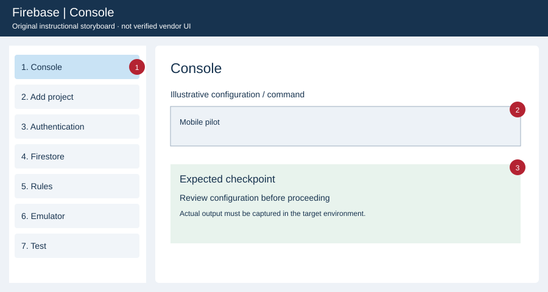
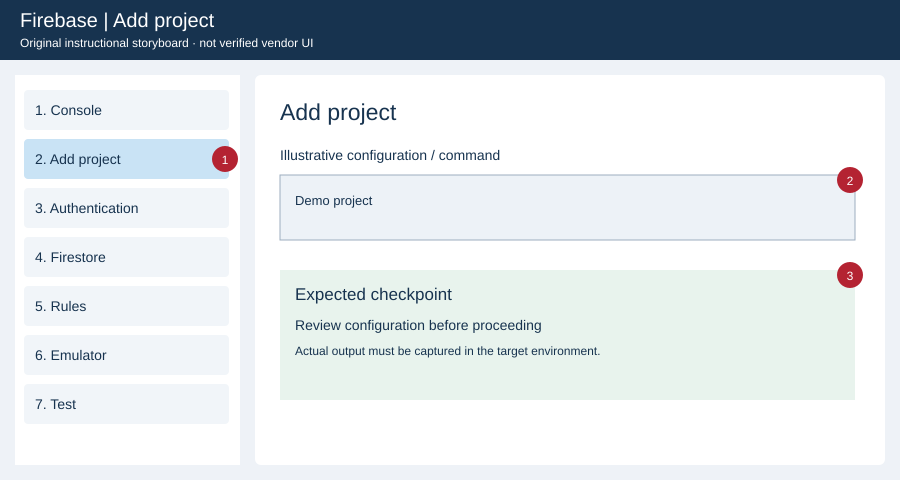
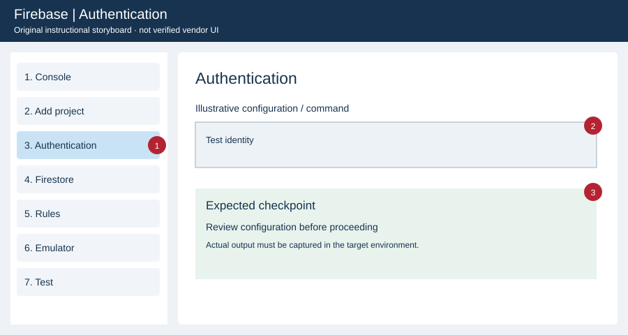
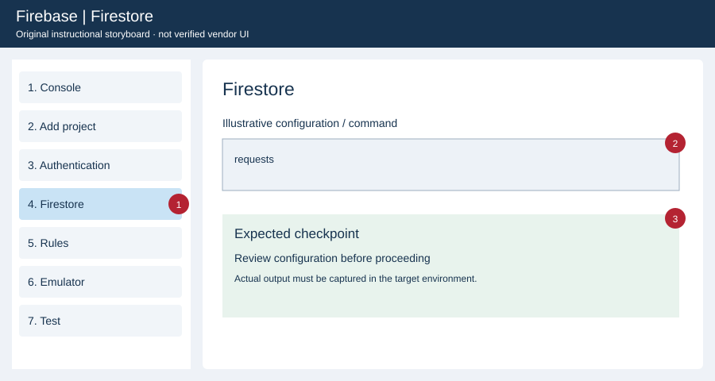
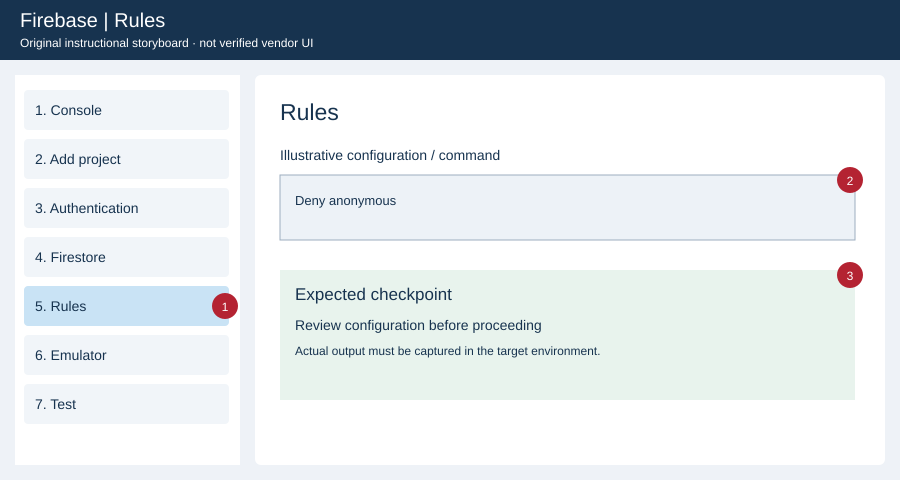
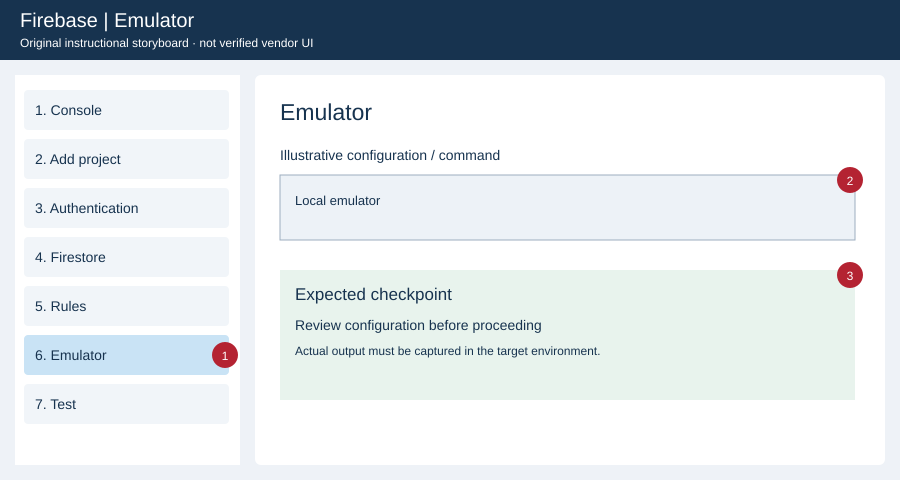
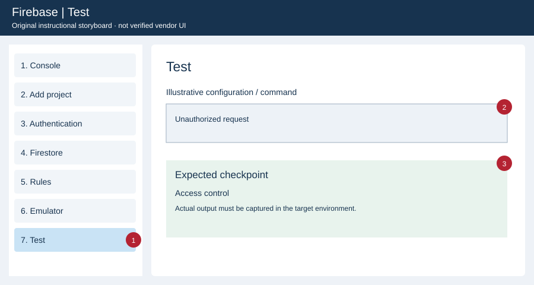

# Firebase — numbered implementation walkthrough

Independent instructional storyboard. The navigation labels below are illustrative task stages, not verified vendor menu paths. No vendor deployment is claimed. Use synthetic data only. Prerequisites: browser for local illustrations; actual platform account, permissions and licensing must be established separately.

## Step 1: Console
1. In the illustrated Firebase workflow, locate callout 1 (Console).
2. Inspect callout 2 and the sample value `Mobile pilot`.
3. Review the expected checkpoint at callout 3: configuration reviewed before continuing.
4. In the real environment, verify the equivalent control and capture actual output before proceeding.

## Step 2: Add project
1. In the illustrated Firebase workflow, locate callout 1 (Add project).
2. Inspect callout 2 and the sample value `Demo project`.
3. Review the expected checkpoint at callout 3: configuration reviewed before continuing.
4. In the real environment, verify the equivalent control and capture actual output before proceeding.

## Step 3: Authentication
1. In the illustrated Firebase workflow, locate callout 1 (Authentication).
2. Inspect callout 2 and the sample value `Test identity`.
3. Review the expected checkpoint at callout 3: configuration reviewed before continuing.
4. In the real environment, verify the equivalent control and capture actual output before proceeding.

## Step 4: Firestore
1. In the illustrated Firebase workflow, locate callout 1 (Firestore).
2. Inspect callout 2 and the sample value `requests`.
3. Review the expected checkpoint at callout 3: configuration reviewed before continuing.
4. In the real environment, verify the equivalent control and capture actual output before proceeding.

## Step 5: Rules
1. In the illustrated Firebase workflow, locate callout 1 (Rules).
2. Inspect callout 2 and the sample value `Deny anonymous`.
3. Review the expected checkpoint at callout 3: configuration reviewed before continuing.
4. In the real environment, verify the equivalent control and capture actual output before proceeding.

## Step 6: Emulator
1. In the illustrated Firebase workflow, locate callout 1 (Emulator).
2. Inspect callout 2 and the sample value `Local emulator`.
3. Review the expected checkpoint at callout 3: configuration reviewed before continuing.
4. In the real environment, verify the equivalent control and capture actual output before proceeding.

## Step 7: Test
1. In the illustrated Firebase workflow, locate callout 1 (Test).
2. Inspect callout 2 and the sample value `Unauthorized request`.
3. Review the expected checkpoint at callout 3: Access control.
4. In the real environment, verify the equivalent control and capture actual output before proceeding.

## Troubleshooting and executive acceptance
If a control is unavailable, verify role permissions, licensing and product version. If validation fails, stop, preserve the error and correct the input. Executive gate: Access control. Record actual test output, reviewer and decision; do not claim completion without evidence.
