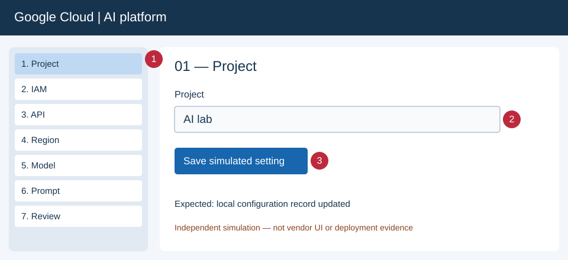
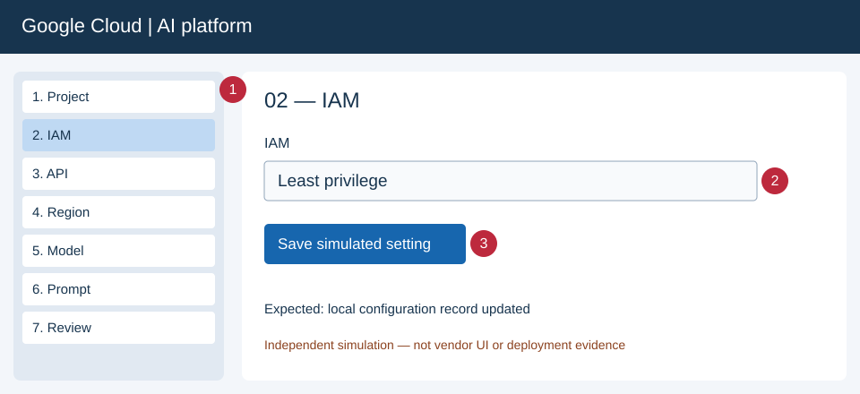
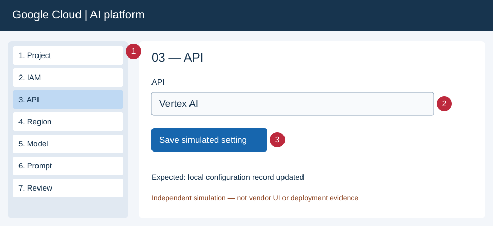
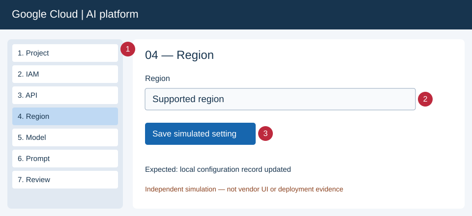
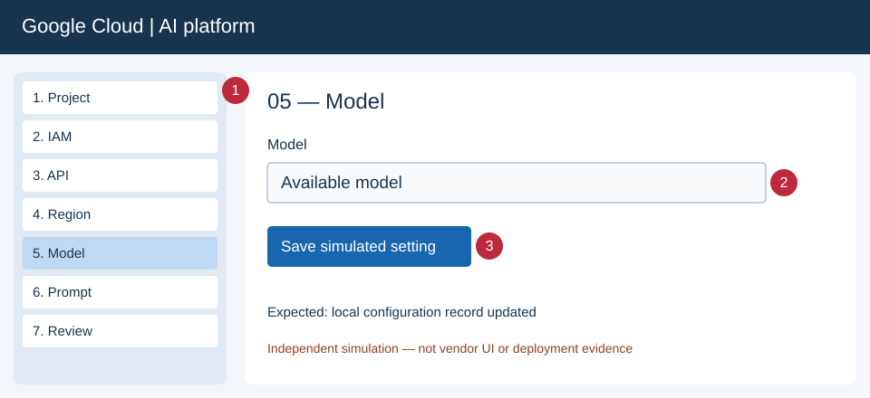
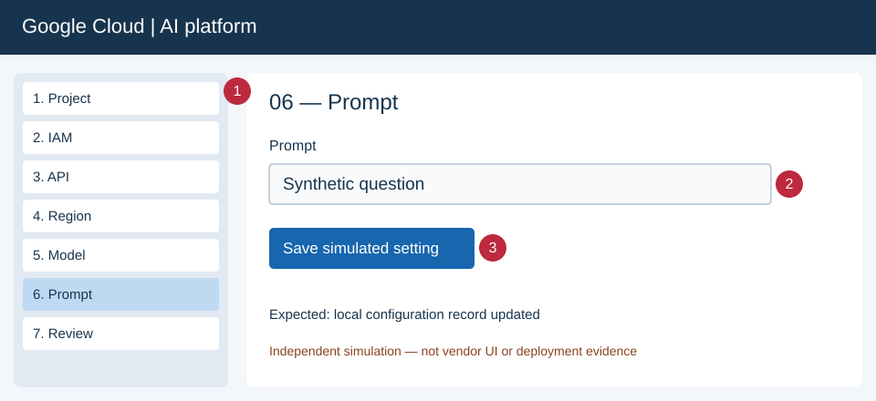
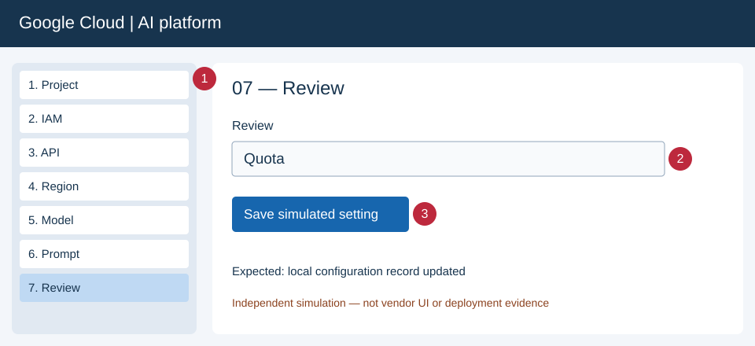

# Google Cloud — AI platform

Original interactive configuration simulation. Download index.html and open locally in a browser. GitHub file preview does not execute HTML. This is not a replica of the vendor interface; settings are illustrative and must be verified in a real sandbox.

[Interactive HTML source](index.html)

## 01 — Project

Select **Project** in the simulation navigation, enter `AI lab`, then select **Save simulated setting**. Confirm the configuration record contains the value before selecting Next step. This verifies local state only.

## 02 — IAM

Select **IAM** in the simulation navigation, enter `Least privilege`, then select **Save simulated setting**. Confirm the configuration record contains the value before selecting Next step. This verifies local state only.

## 03 — API

Select **API** in the simulation navigation, enter `Vertex AI`, then select **Save simulated setting**. Confirm the configuration record contains the value before selecting Next step. This verifies local state only.

## 04 — Region

Select **Region** in the simulation navigation, enter `Supported region`, then select **Save simulated setting**. Confirm the configuration record contains the value before selecting Next step. This verifies local state only.

## 05 — Model

Select **Model** in the simulation navigation, enter `Available model`, then select **Save simulated setting**. Confirm the configuration record contains the value before selecting Next step. This verifies local state only.

## 06 — Prompt

Select **Prompt** in the simulation navigation, enter `Synthetic question`, then select **Save simulated setting**. Confirm the configuration record contains the value before selecting Next step. This verifies local state only.

## 07 — Review

Select **Review** in the simulation navigation, enter `Quota`, then select **Save simulated setting**. Confirm the configuration record contains the value before selecting Next step. This verifies local state only.

