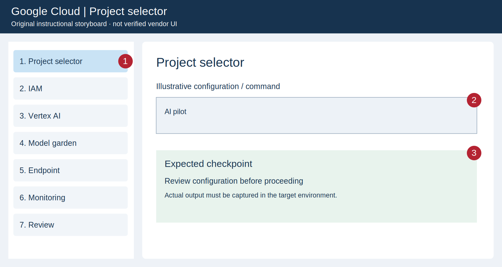
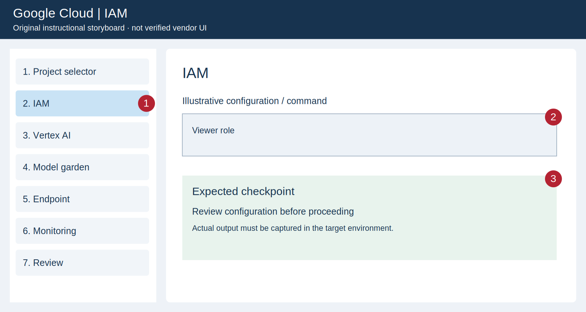
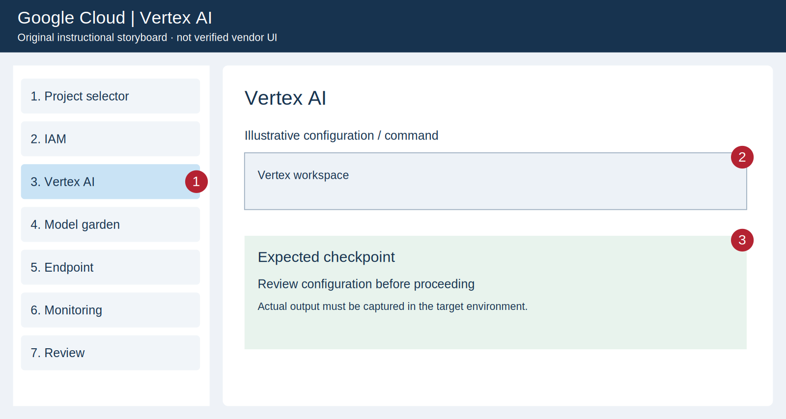
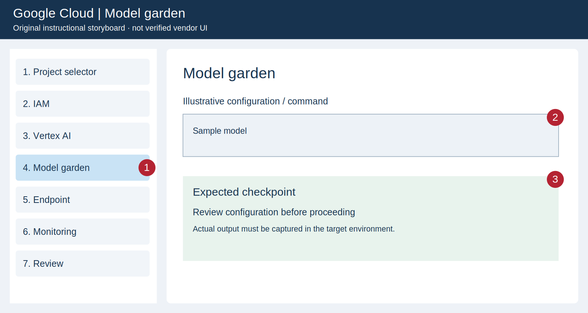
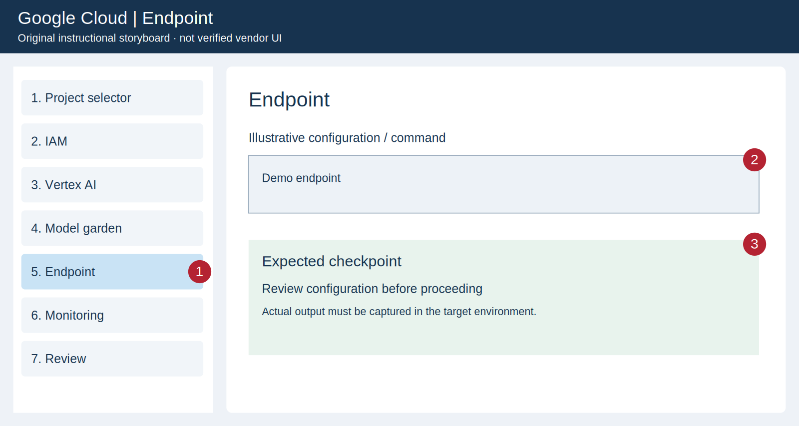
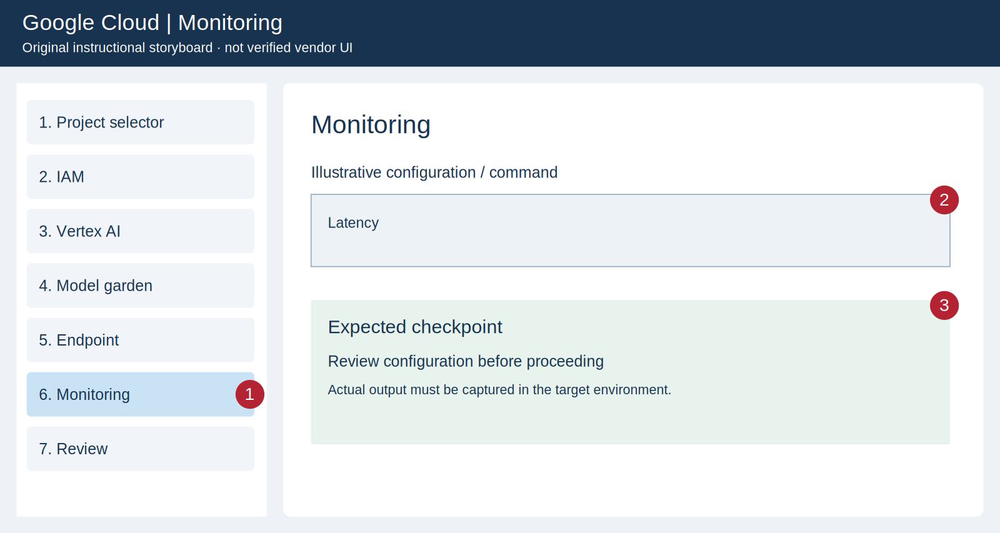
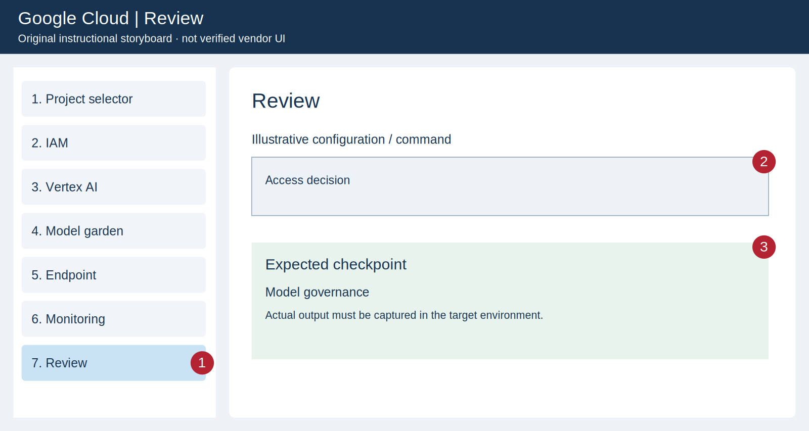

# Google Cloud — numbered implementation walkthrough

Independent instructional storyboard. The navigation labels below are illustrative task stages, not verified vendor menu paths. No vendor deployment is claimed. Use synthetic data only. Prerequisites: browser for local illustrations; actual platform account, permissions and licensing must be established separately.

## Step 1: Project selector
1. In the illustrated Google Cloud workflow, locate callout 1 (Project selector).
2. Inspect callout 2 and the sample value `AI pilot`.
3. Review the expected checkpoint at callout 3: configuration reviewed before continuing.
4. In the real environment, verify the equivalent control and capture actual output before proceeding.

## Step 2: IAM
1. In the illustrated Google Cloud workflow, locate callout 1 (IAM).
2. Inspect callout 2 and the sample value `Viewer role`.
3. Review the expected checkpoint at callout 3: configuration reviewed before continuing.
4. In the real environment, verify the equivalent control and capture actual output before proceeding.

## Step 3: Vertex AI
1. In the illustrated Google Cloud workflow, locate callout 1 (Vertex AI).
2. Inspect callout 2 and the sample value `Vertex workspace`.
3. Review the expected checkpoint at callout 3: configuration reviewed before continuing.
4. In the real environment, verify the equivalent control and capture actual output before proceeding.

## Step 4: Model garden
1. In the illustrated Google Cloud workflow, locate callout 1 (Model garden).
2. Inspect callout 2 and the sample value `Sample model`.
3. Review the expected checkpoint at callout 3: configuration reviewed before continuing.
4. In the real environment, verify the equivalent control and capture actual output before proceeding.

## Step 5: Endpoint
1. In the illustrated Google Cloud workflow, locate callout 1 (Endpoint).
2. Inspect callout 2 and the sample value `Demo endpoint`.
3. Review the expected checkpoint at callout 3: configuration reviewed before continuing.
4. In the real environment, verify the equivalent control and capture actual output before proceeding.

## Step 6: Monitoring
1. In the illustrated Google Cloud workflow, locate callout 1 (Monitoring).
2. Inspect callout 2 and the sample value `Latency`.
3. Review the expected checkpoint at callout 3: configuration reviewed before continuing.
4. In the real environment, verify the equivalent control and capture actual output before proceeding.

## Step 7: Review
1. In the illustrated Google Cloud workflow, locate callout 1 (Review).
2. Inspect callout 2 and the sample value `Access decision`.
3. Review the expected checkpoint at callout 3: Model governance.
4. In the real environment, verify the equivalent control and capture actual output before proceeding.

## Troubleshooting and executive acceptance
If a control is unavailable, verify role permissions, licensing and product version. If validation fails, stop, preserve the error and correct the input. Executive gate: Model governance. Record actual test output, reviewer and decision; do not claim completion without evidence.
