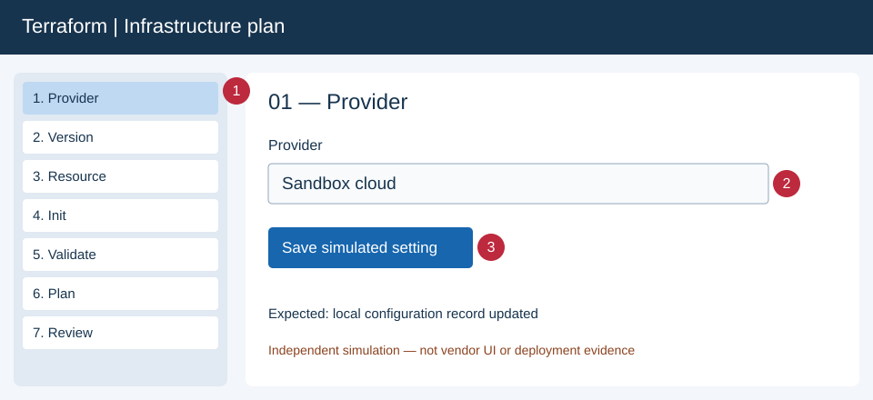
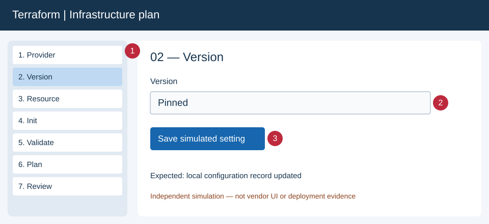
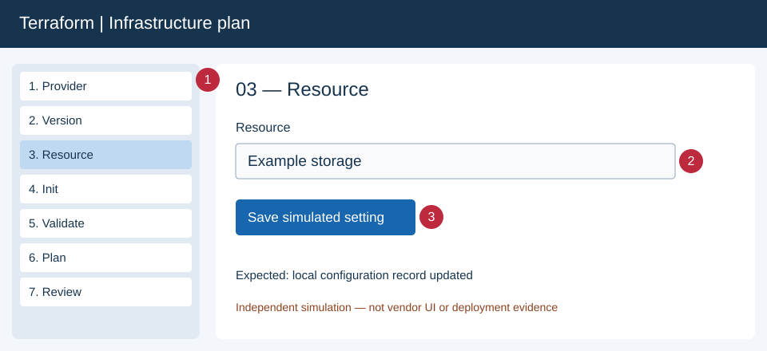
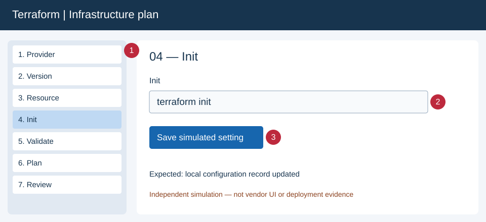
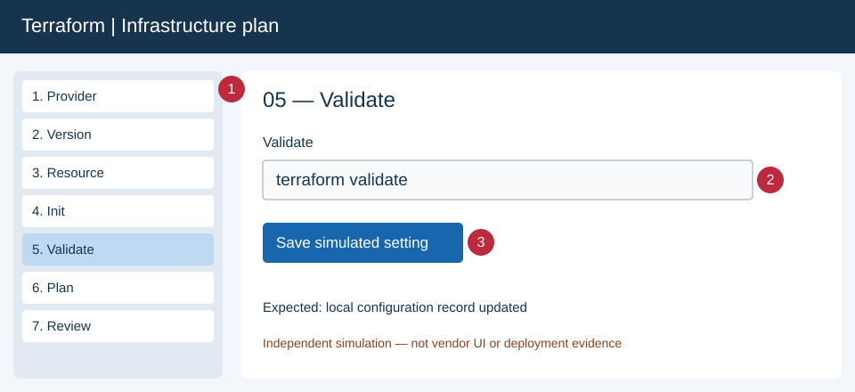
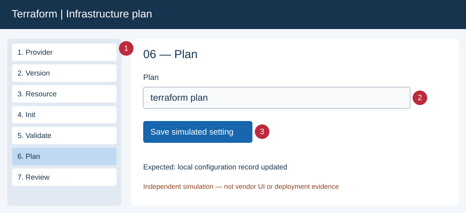
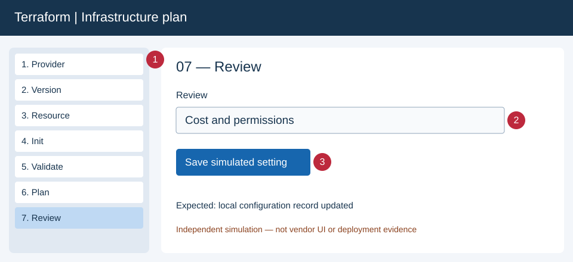

# Terraform — Infrastructure plan

Original interactive configuration simulation. Download index.html and open locally in a browser. GitHub file preview does not execute HTML. This is not a replica of the vendor interface; settings are illustrative and must be verified in a real sandbox.

[Interactive HTML source](index.html)

## 01 — Provider

Select **Provider** in the simulation navigation, enter `Sandbox cloud`, then select **Save simulated setting**. Confirm the configuration record contains the value before selecting Next step. This verifies local state only.

## 02 — Version

Select **Version** in the simulation navigation, enter `Pinned`, then select **Save simulated setting**. Confirm the configuration record contains the value before selecting Next step. This verifies local state only.

## 03 — Resource

Select **Resource** in the simulation navigation, enter `Example storage`, then select **Save simulated setting**. Confirm the configuration record contains the value before selecting Next step. This verifies local state only.

## 04 — Init

Select **Init** in the simulation navigation, enter `terraform init`, then select **Save simulated setting**. Confirm the configuration record contains the value before selecting Next step. This verifies local state only.

## 05 — Validate

Select **Validate** in the simulation navigation, enter `terraform validate`, then select **Save simulated setting**. Confirm the configuration record contains the value before selecting Next step. This verifies local state only.

## 06 — Plan

Select **Plan** in the simulation navigation, enter `terraform plan`, then select **Save simulated setting**. Confirm the configuration record contains the value before selecting Next step. This verifies local state only.

## 07 — Review

Select **Review** in the simulation navigation, enter `Cost and permissions`, then select **Save simulated setting**. Confirm the configuration record contains the value before selecting Next step. This verifies local state only.

