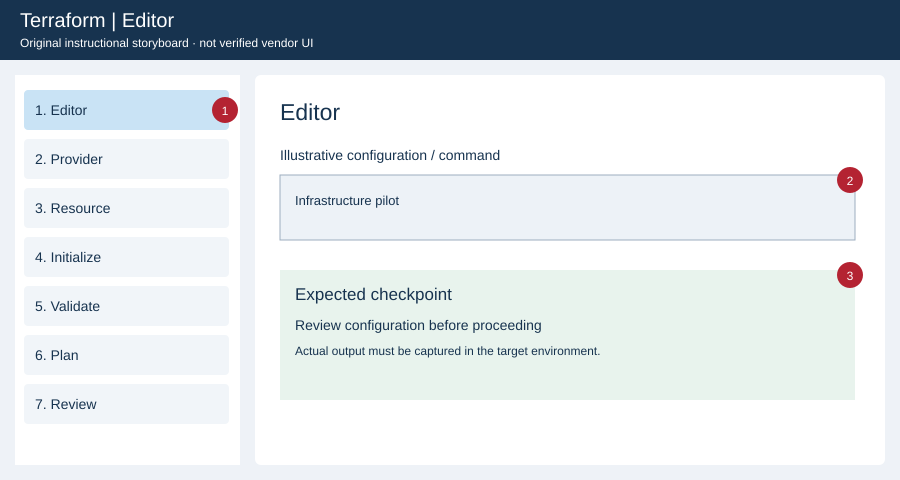
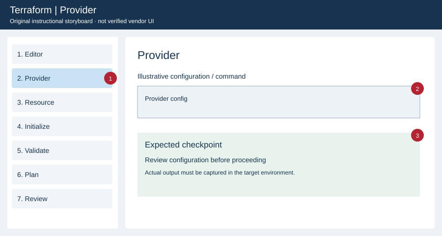
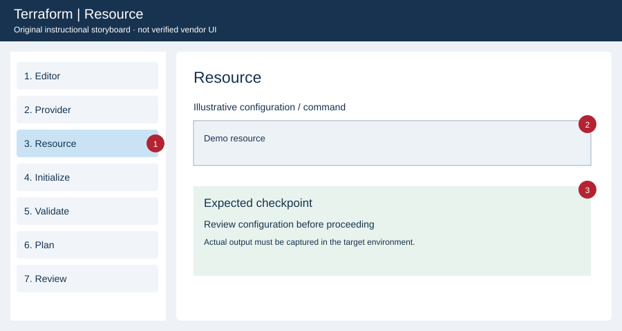
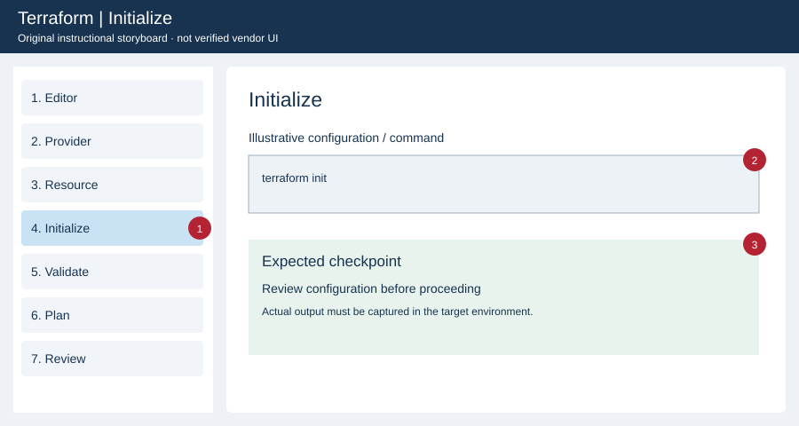
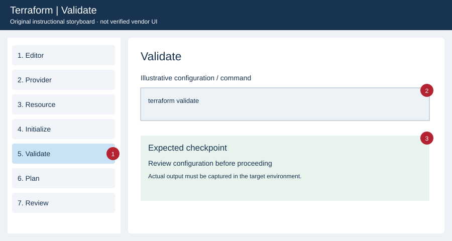
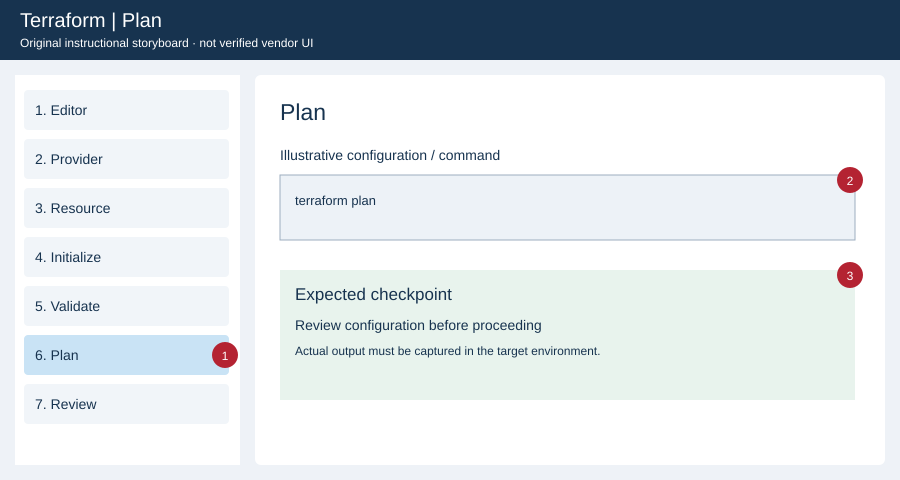
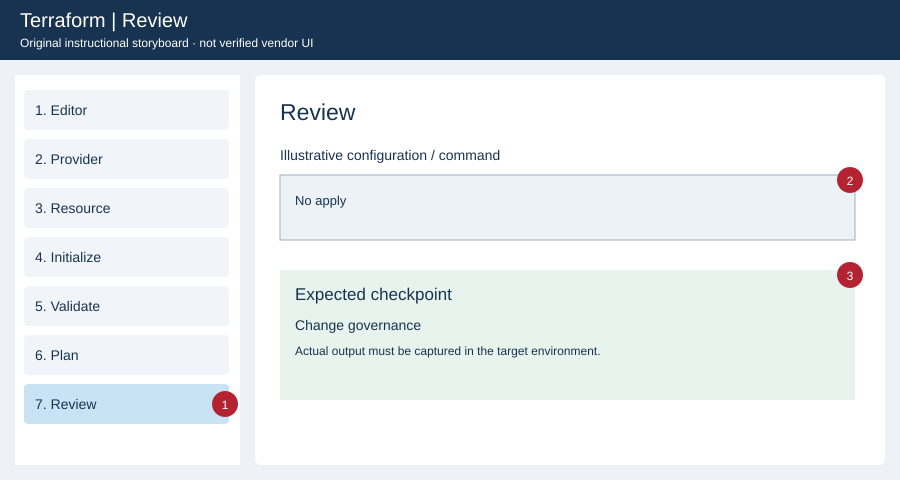

# Terraform — numbered implementation walkthrough

Independent instructional storyboard. The navigation labels below are illustrative task stages, not verified vendor menu paths. No vendor deployment is claimed. Use synthetic data only. Prerequisites: browser for local illustrations; actual platform account, permissions and licensing must be established separately.

## Step 1: Editor
1. In the illustrated Terraform workflow, locate callout 1 (Editor).
2. Inspect callout 2 and the sample value `Infrastructure pilot`.
3. Review the expected checkpoint at callout 3: configuration reviewed before continuing.
4. In the real environment, verify the equivalent control and capture actual output before proceeding.

## Step 2: Provider
1. In the illustrated Terraform workflow, locate callout 1 (Provider).
2. Inspect callout 2 and the sample value `Provider config`.
3. Review the expected checkpoint at callout 3: configuration reviewed before continuing.
4. In the real environment, verify the equivalent control and capture actual output before proceeding.

## Step 3: Resource
1. In the illustrated Terraform workflow, locate callout 1 (Resource).
2. Inspect callout 2 and the sample value `Demo resource`.
3. Review the expected checkpoint at callout 3: configuration reviewed before continuing.
4. In the real environment, verify the equivalent control and capture actual output before proceeding.

## Step 4: Initialize
1. In the illustrated Terraform workflow, locate callout 1 (Initialize).
2. Inspect callout 2 and the sample value `terraform init`.
3. Review the expected checkpoint at callout 3: configuration reviewed before continuing.
4. In the real environment, verify the equivalent control and capture actual output before proceeding.

## Step 5: Validate
1. In the illustrated Terraform workflow, locate callout 1 (Validate).
2. Inspect callout 2 and the sample value `terraform validate`.
3. Review the expected checkpoint at callout 3: configuration reviewed before continuing.
4. In the real environment, verify the equivalent control and capture actual output before proceeding.

## Step 6: Plan
1. In the illustrated Terraform workflow, locate callout 1 (Plan).
2. Inspect callout 2 and the sample value `terraform plan`.
3. Review the expected checkpoint at callout 3: configuration reviewed before continuing.
4. In the real environment, verify the equivalent control and capture actual output before proceeding.

## Step 7: Review
1. In the illustrated Terraform workflow, locate callout 1 (Review).
2. Inspect callout 2 and the sample value `No apply`.
3. Review the expected checkpoint at callout 3: Change governance.
4. In the real environment, verify the equivalent control and capture actual output before proceeding.

## Troubleshooting and executive acceptance
If a control is unavailable, verify role permissions, licensing and product version. If validation fails, stop, preserve the error and correct the input. Executive gate: Change governance. Record actual test output, reviewer and decision; do not claim completion without evidence.
