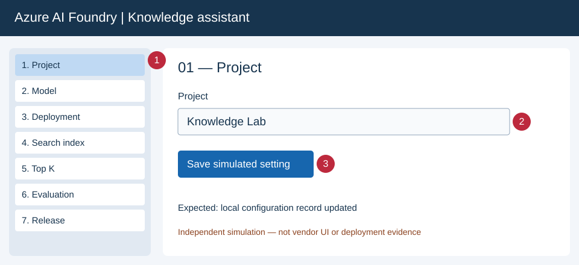
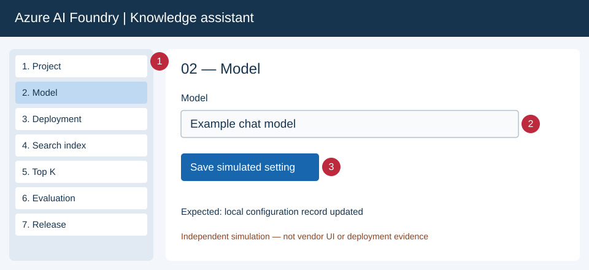
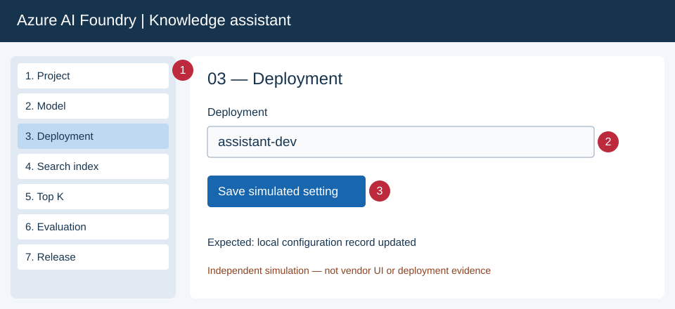
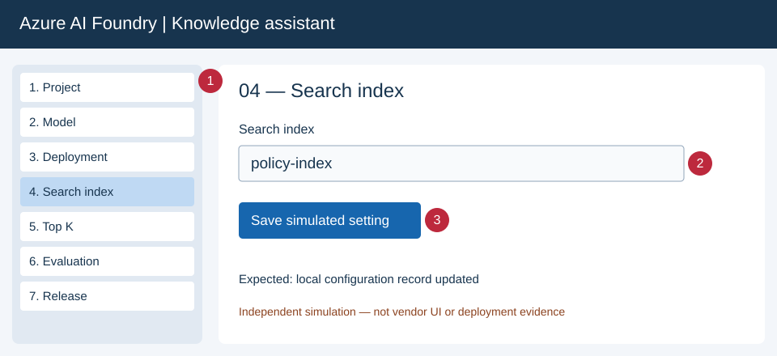
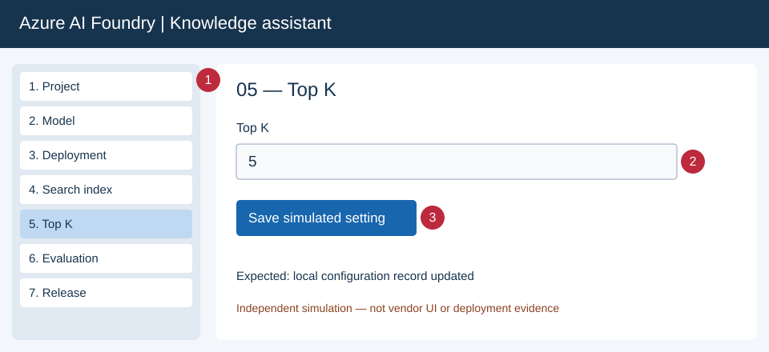
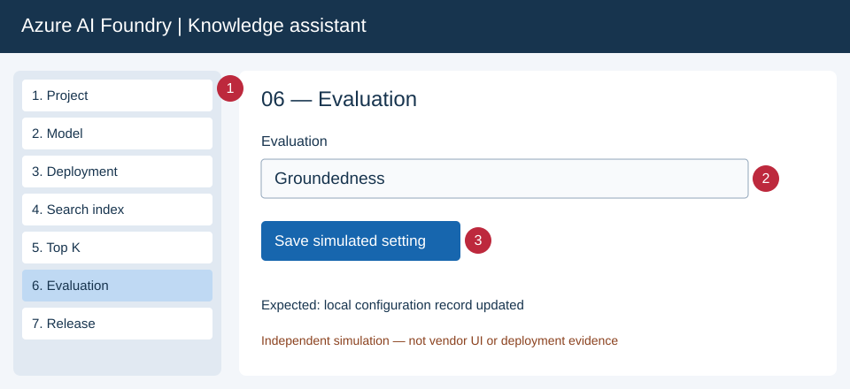
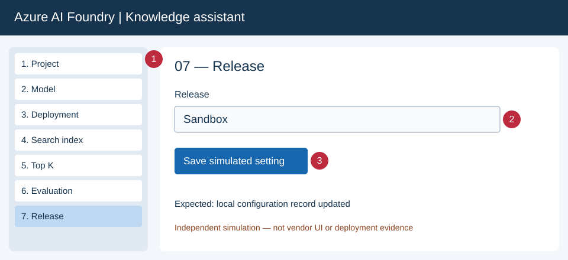

# Azure AI Foundry — Knowledge assistant

Original interactive configuration simulation. Download index.html and open locally in a browser. GitHub file preview does not execute HTML. This is not a replica of the vendor interface; settings are illustrative and must be verified in a real sandbox.

[Interactive HTML source](index.html)

## 01 — Project

Select **Project** in the simulation navigation, enter `Knowledge Lab`, then select **Save simulated setting**. Confirm the configuration record contains the value before selecting Next step. This verifies local state only.

## 02 — Model

Select **Model** in the simulation navigation, enter `Example chat model`, then select **Save simulated setting**. Confirm the configuration record contains the value before selecting Next step. This verifies local state only.

## 03 — Deployment

Select **Deployment** in the simulation navigation, enter `assistant-dev`, then select **Save simulated setting**. Confirm the configuration record contains the value before selecting Next step. This verifies local state only.

## 04 — Search index

Select **Search index** in the simulation navigation, enter `policy-index`, then select **Save simulated setting**. Confirm the configuration record contains the value before selecting Next step. This verifies local state only.

## 05 — Top K

Select **Top K** in the simulation navigation, enter `5`, then select **Save simulated setting**. Confirm the configuration record contains the value before selecting Next step. This verifies local state only.

## 06 — Evaluation

Select **Evaluation** in the simulation navigation, enter `Groundedness`, then select **Save simulated setting**. Confirm the configuration record contains the value before selecting Next step. This verifies local state only.

## 07 — Release

Select **Release** in the simulation navigation, enter `Sandbox`, then select **Save simulated setting**. Confirm the configuration record contains the value before selecting Next step. This verifies local state only.

