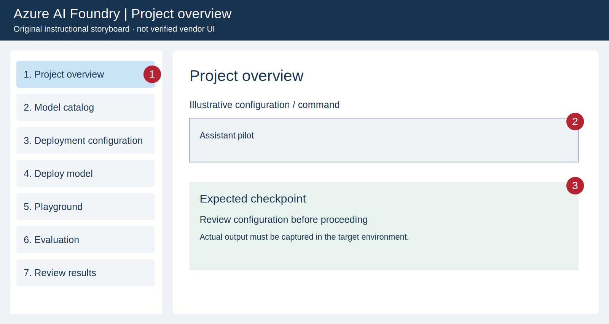
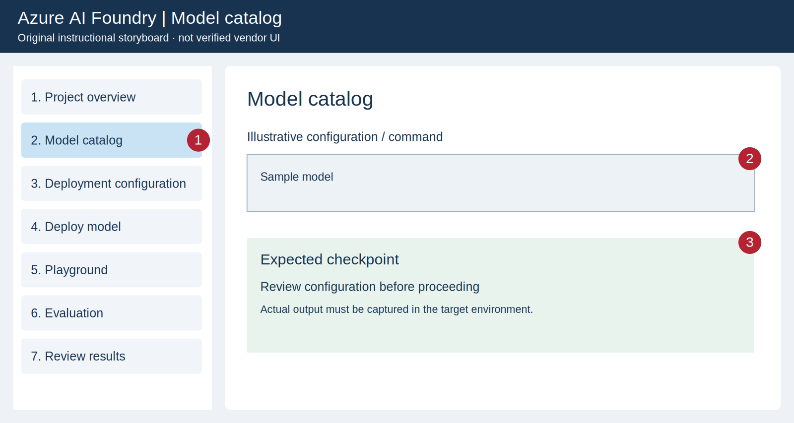
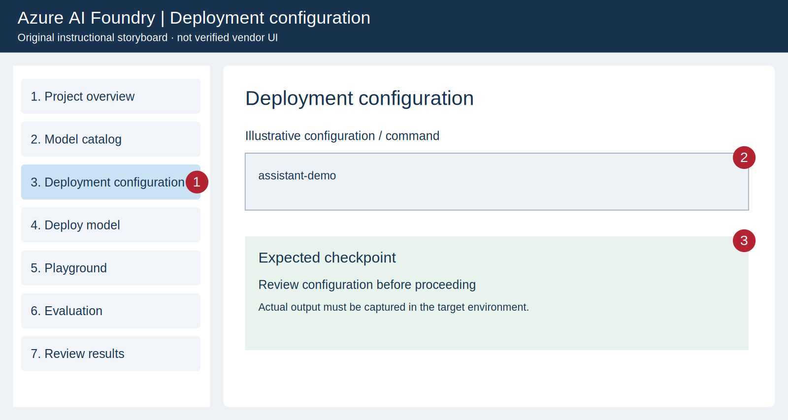
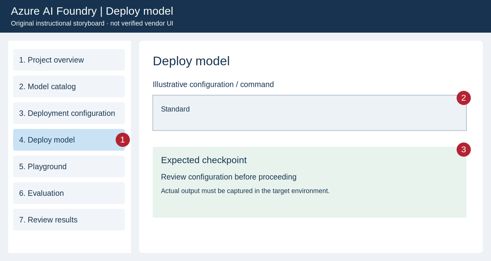
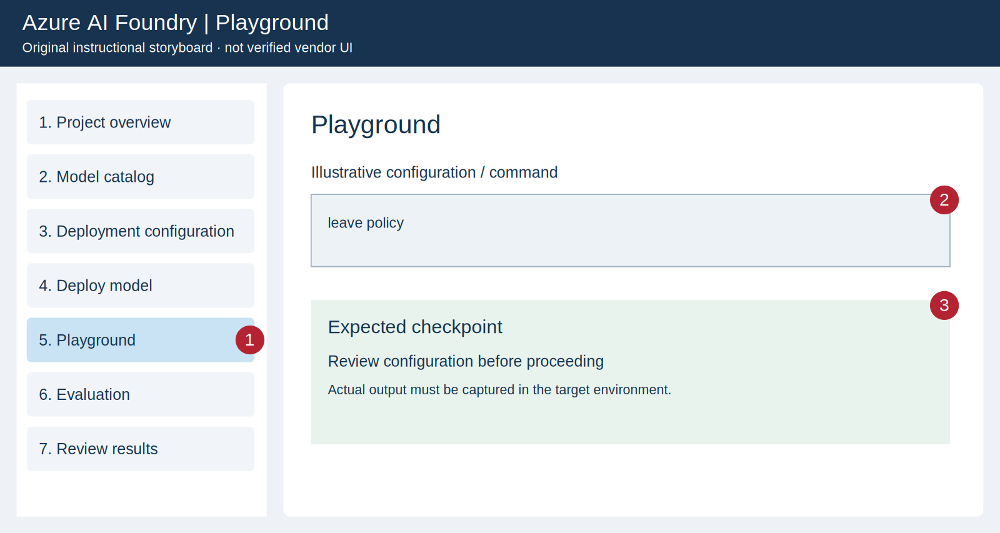
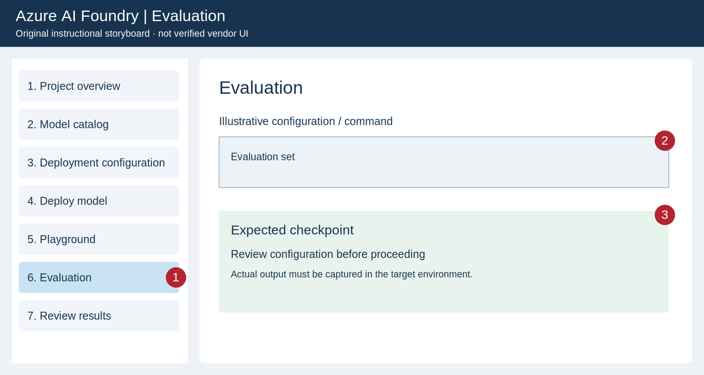
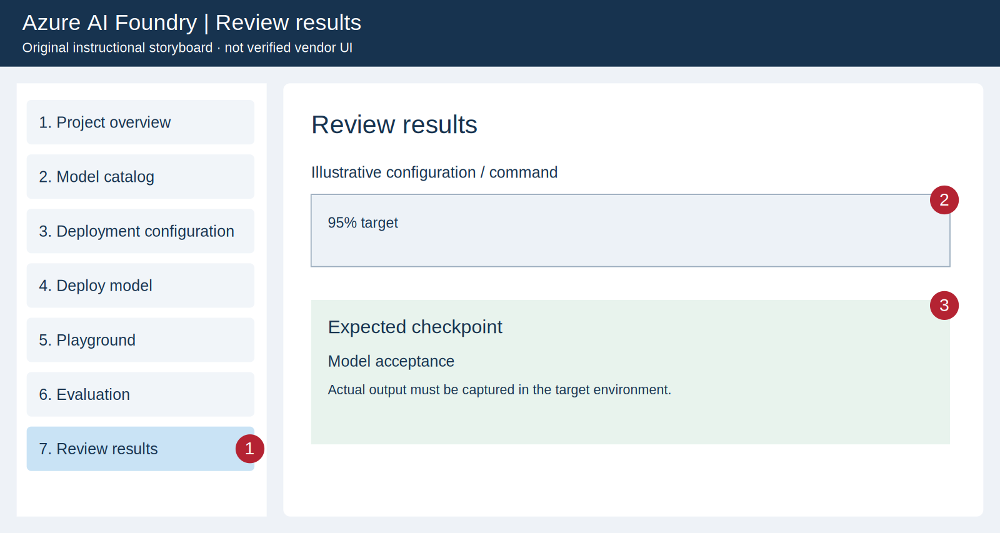

# Azure AI Foundry — numbered implementation walkthrough

Independent instructional storyboard. The navigation labels below are illustrative task stages, not verified vendor menu paths. No vendor deployment is claimed. Use synthetic data only. Prerequisites: browser for local illustrations; actual platform account, permissions and licensing must be established separately.

## Step 1: Project overview
1. In the illustrated Azure AI Foundry workflow, locate callout 1 (Project overview).
2. Inspect callout 2 and the sample value `Assistant pilot`.
3. Review the expected checkpoint at callout 3: configuration reviewed before continuing.
4. In the real environment, verify the equivalent control and capture actual output before proceeding.

## Step 2: Model catalog
1. In the illustrated Azure AI Foundry workflow, locate callout 1 (Model catalog).
2. Inspect callout 2 and the sample value `Sample model`.
3. Review the expected checkpoint at callout 3: configuration reviewed before continuing.
4. In the real environment, verify the equivalent control and capture actual output before proceeding.

## Step 3: Deployment configuration
1. In the illustrated Azure AI Foundry workflow, locate callout 1 (Deployment configuration).
2. Inspect callout 2 and the sample value `assistant-demo`.
3. Review the expected checkpoint at callout 3: configuration reviewed before continuing.
4. In the real environment, verify the equivalent control and capture actual output before proceeding.

## Step 4: Deploy model
1. In the illustrated Azure AI Foundry workflow, locate callout 1 (Deploy model).
2. Inspect callout 2 and the sample value `Standard`.
3. Review the expected checkpoint at callout 3: configuration reviewed before continuing.
4. In the real environment, verify the equivalent control and capture actual output before proceeding.

## Step 5: Playground
1. In the illustrated Azure AI Foundry workflow, locate callout 1 (Playground).
2. Inspect callout 2 and the sample value `leave policy`.
3. Review the expected checkpoint at callout 3: configuration reviewed before continuing.
4. In the real environment, verify the equivalent control and capture actual output before proceeding.

## Step 6: Evaluation
1. In the illustrated Azure AI Foundry workflow, locate callout 1 (Evaluation).
2. Inspect callout 2 and the sample value `Evaluation set`.
3. Review the expected checkpoint at callout 3: configuration reviewed before continuing.
4. In the real environment, verify the equivalent control and capture actual output before proceeding.

## Step 7: Review results
1. In the illustrated Azure AI Foundry workflow, locate callout 1 (Review results).
2. Inspect callout 2 and the sample value `95% target`.
3. Review the expected checkpoint at callout 3: Model acceptance.
4. In the real environment, verify the equivalent control and capture actual output before proceeding.

## Troubleshooting and executive acceptance
If a control is unavailable, verify role permissions, licensing and product version. If validation fails, stop, preserve the error and correct the input. Executive gate: Model acceptance. Record actual test output, reviewer and decision; do not claim completion without evidence.
