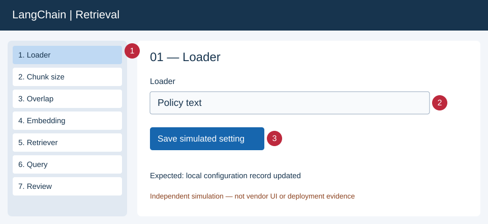
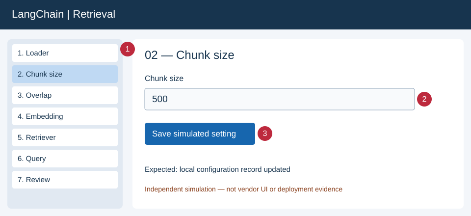
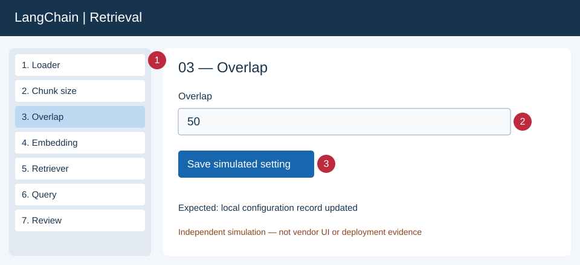
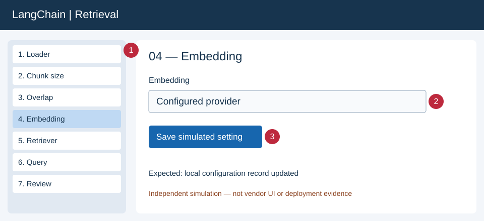
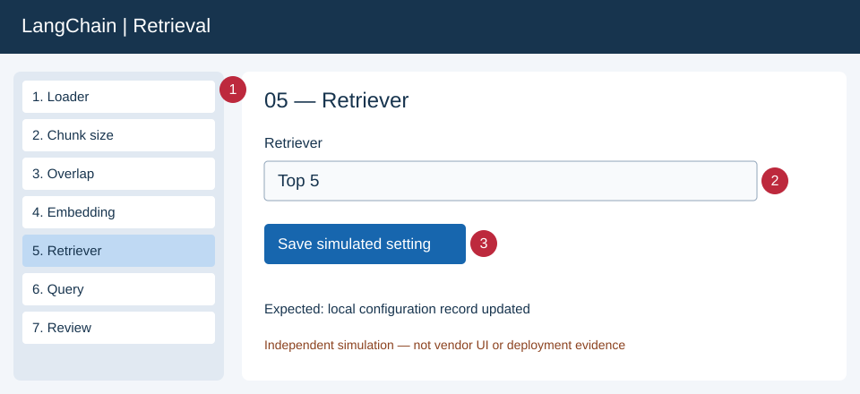
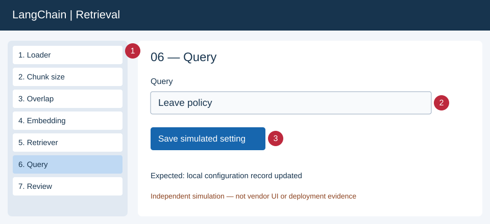
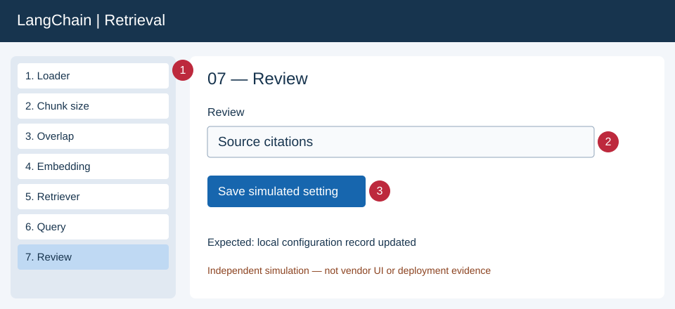

# LangChain — Retrieval

Original interactive configuration simulation. Download index.html and open locally in a browser. GitHub file preview does not execute HTML. This is not a replica of the vendor interface; settings are illustrative and must be verified in a real sandbox.

[Interactive HTML source](index.html)

## 01 — Loader

Select **Loader** in the simulation navigation, enter `Policy text`, then select **Save simulated setting**. Confirm the configuration record contains the value before selecting Next step. This verifies local state only.

## 02 — Chunk size

Select **Chunk size** in the simulation navigation, enter `500`, then select **Save simulated setting**. Confirm the configuration record contains the value before selecting Next step. This verifies local state only.

## 03 — Overlap

Select **Overlap** in the simulation navigation, enter `50`, then select **Save simulated setting**. Confirm the configuration record contains the value before selecting Next step. This verifies local state only.

## 04 — Embedding

Select **Embedding** in the simulation navigation, enter `Configured provider`, then select **Save simulated setting**. Confirm the configuration record contains the value before selecting Next step. This verifies local state only.

## 05 — Retriever

Select **Retriever** in the simulation navigation, enter `Top 5`, then select **Save simulated setting**. Confirm the configuration record contains the value before selecting Next step. This verifies local state only.

## 06 — Query

Select **Query** in the simulation navigation, enter `Leave policy`, then select **Save simulated setting**. Confirm the configuration record contains the value before selecting Next step. This verifies local state only.

## 07 — Review

Select **Review** in the simulation navigation, enter `Source citations`, then select **Save simulated setting**. Confirm the configuration record contains the value before selecting Next step. This verifies local state only.

