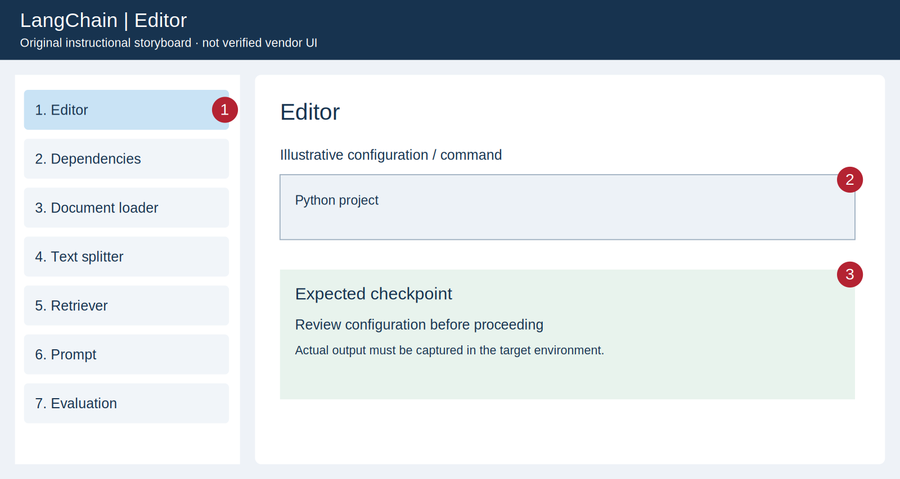
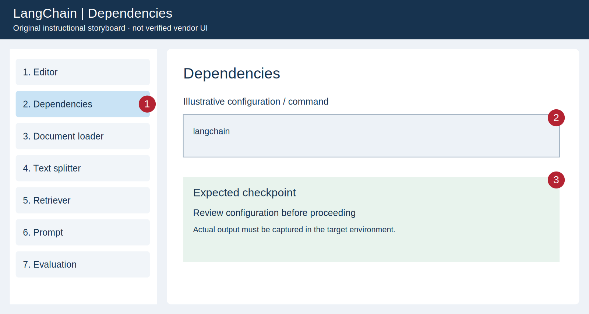
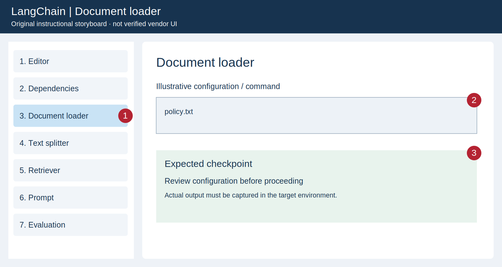
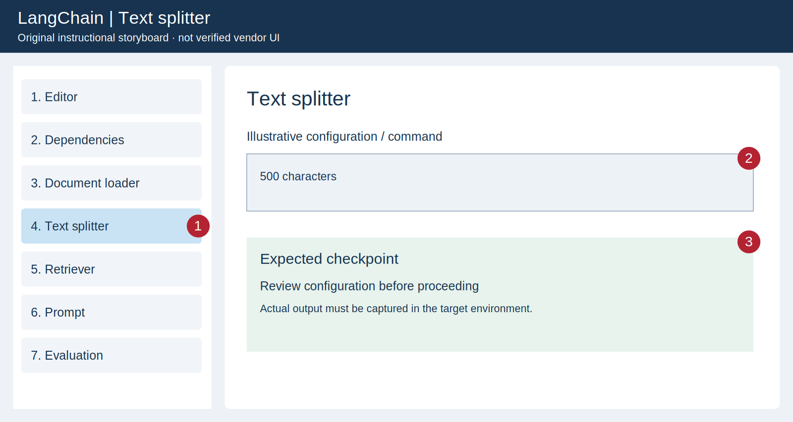
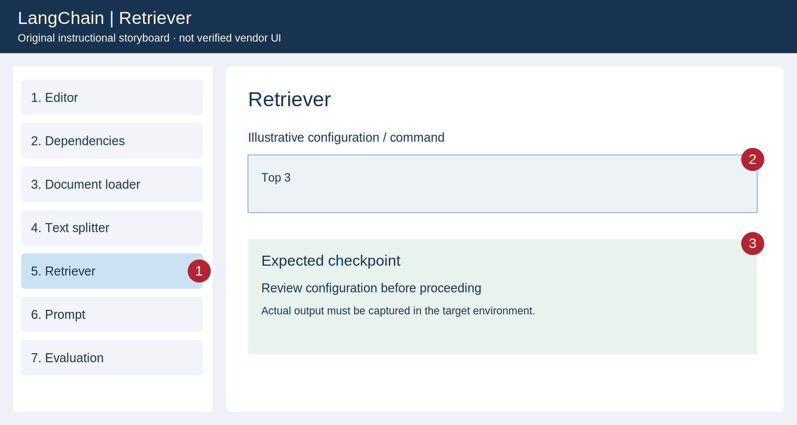
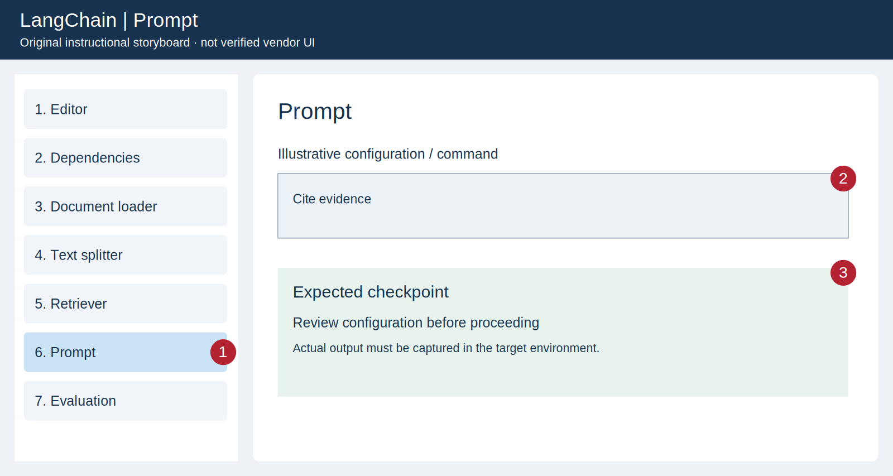
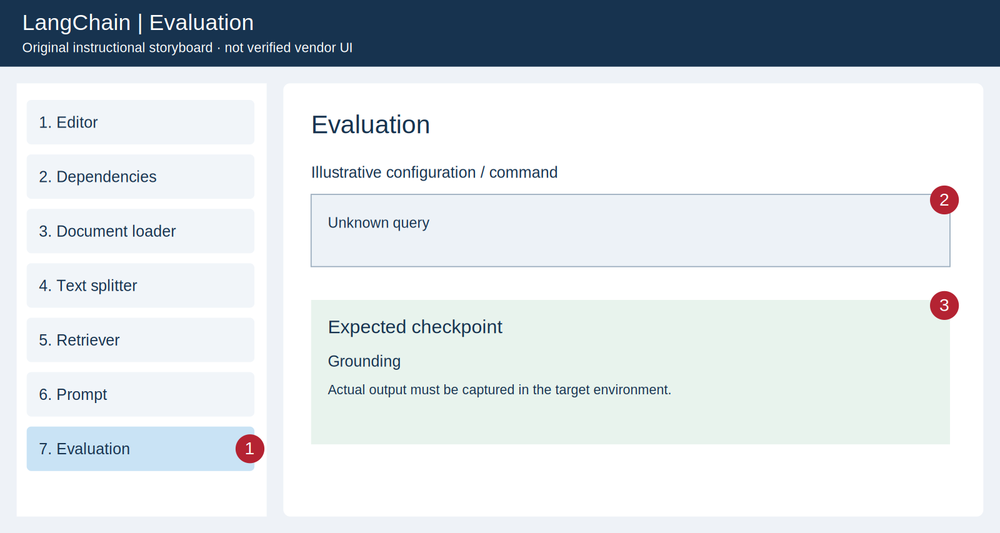

# LangChain — numbered implementation walkthrough

Independent instructional storyboard. The navigation labels below are illustrative task stages, not verified vendor menu paths. No vendor deployment is claimed. Use synthetic data only. Prerequisites: browser for local illustrations; actual platform account, permissions and licensing must be established separately.

## Step 1: Editor
1. In the illustrated LangChain workflow, locate callout 1 (Editor).
2. Inspect callout 2 and the sample value `Python project`.
3. Review the expected checkpoint at callout 3: configuration reviewed before continuing.
4. In the real environment, verify the equivalent control and capture actual output before proceeding.

## Step 2: Dependencies
1. In the illustrated LangChain workflow, locate callout 1 (Dependencies).
2. Inspect callout 2 and the sample value `langchain`.
3. Review the expected checkpoint at callout 3: configuration reviewed before continuing.
4. In the real environment, verify the equivalent control and capture actual output before proceeding.

## Step 3: Document loader
1. In the illustrated LangChain workflow, locate callout 1 (Document loader).
2. Inspect callout 2 and the sample value `policy.txt`.
3. Review the expected checkpoint at callout 3: configuration reviewed before continuing.
4. In the real environment, verify the equivalent control and capture actual output before proceeding.

## Step 4: Text splitter
1. In the illustrated LangChain workflow, locate callout 1 (Text splitter).
2. Inspect callout 2 and the sample value `500 characters`.
3. Review the expected checkpoint at callout 3: configuration reviewed before continuing.
4. In the real environment, verify the equivalent control and capture actual output before proceeding.

## Step 5: Retriever
1. In the illustrated LangChain workflow, locate callout 1 (Retriever).
2. Inspect callout 2 and the sample value `Top 3`.
3. Review the expected checkpoint at callout 3: configuration reviewed before continuing.
4. In the real environment, verify the equivalent control and capture actual output before proceeding.

## Step 6: Prompt
1. In the illustrated LangChain workflow, locate callout 1 (Prompt).
2. Inspect callout 2 and the sample value `Cite evidence`.
3. Review the expected checkpoint at callout 3: configuration reviewed before continuing.
4. In the real environment, verify the equivalent control and capture actual output before proceeding.

## Step 7: Evaluation
1. In the illustrated LangChain workflow, locate callout 1 (Evaluation).
2. Inspect callout 2 and the sample value `Unknown query`.
3. Review the expected checkpoint at callout 3: Grounding.
4. In the real environment, verify the equivalent control and capture actual output before proceeding.

## Troubleshooting and executive acceptance
If a control is unavailable, verify role permissions, licensing and product version. If validation fails, stop, preserve the error and correct the input. Executive gate: Grounding. Record actual test output, reviewer and decision; do not claim completion without evidence.
