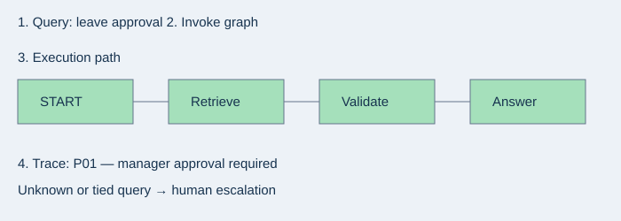

# Agent graph execution lab

Original LangGraph-inspired simulation, not actual framework runtime or official UI.

1. Open index.html locally.
2. Enter `leave approval` in Query.
3. Click Invoke graph.
4. Inspect highlighted START, Retrieve, Validate, Answer nodes and P01 evidence in trace.
5. Enter `unknown` and invoke; expect Escalate and no evidence.
6. Enter `leave expenses`; tied scores must escalate.

Executive acceptance: demonstrate safe escalation before funding a framework pilot. Deterministic JavaScript lexical retrieval only.

