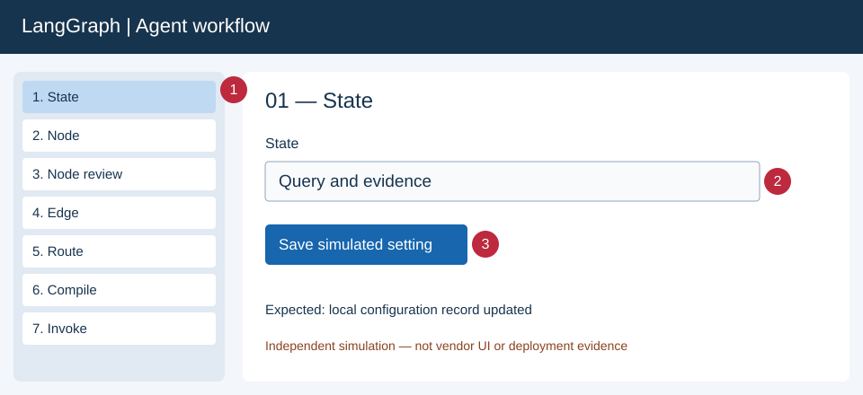
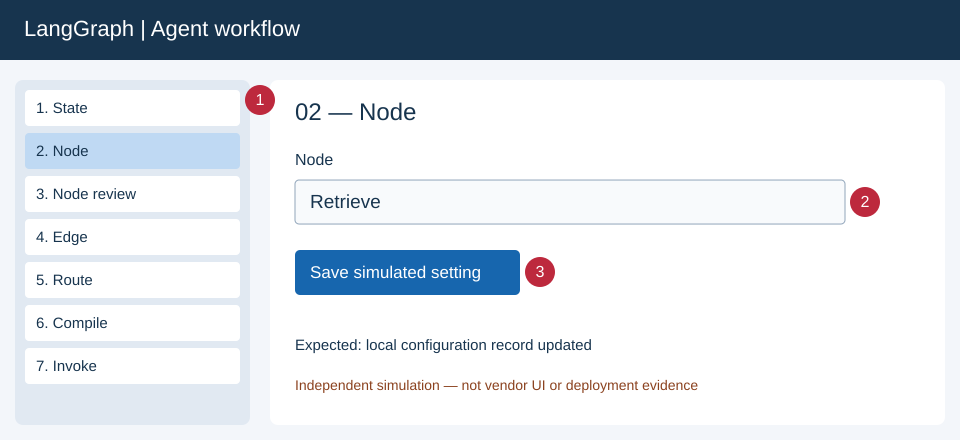
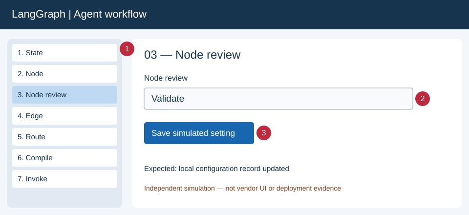
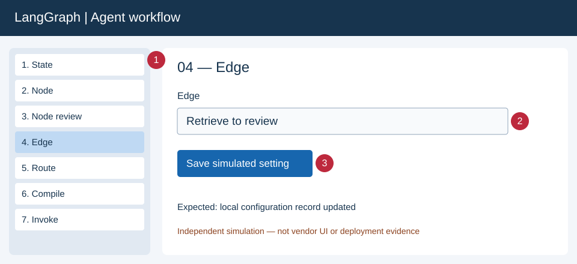
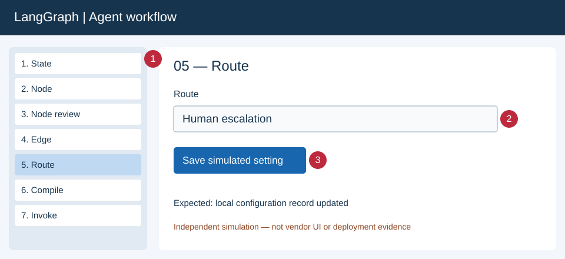
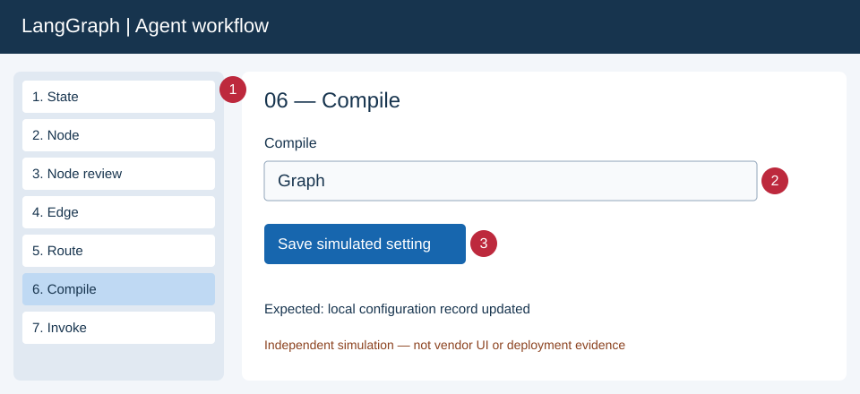
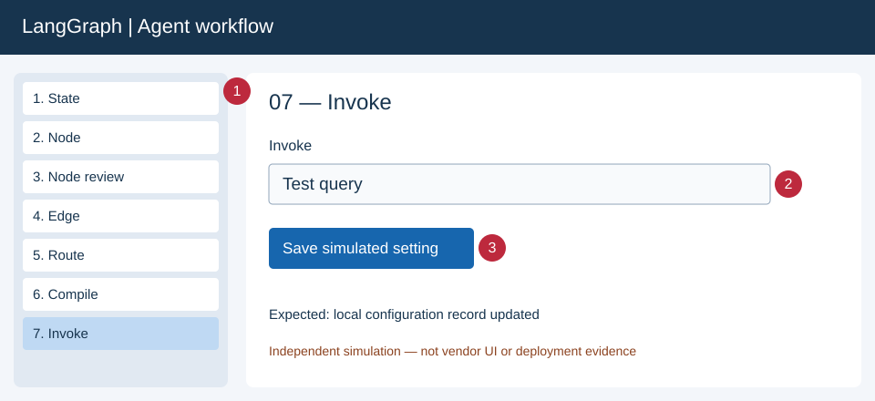

# LangGraph — Agent workflow

Original interactive configuration simulation. Download index.html and open locally in a browser. GitHub file preview does not execute HTML. This is not a replica of the vendor interface; settings are illustrative and must be verified in a real sandbox.

[Interactive HTML source](index.html)

## 01 — State

Select **State** in the simulation navigation, enter `Query and evidence`, then select **Save simulated setting**. Confirm the configuration record contains the value before selecting Next step. This verifies local state only.

## 02 — Node

Select **Node** in the simulation navigation, enter `Retrieve`, then select **Save simulated setting**. Confirm the configuration record contains the value before selecting Next step. This verifies local state only.

## 03 — Node review

Select **Node review** in the simulation navigation, enter `Validate`, then select **Save simulated setting**. Confirm the configuration record contains the value before selecting Next step. This verifies local state only.

## 04 — Edge

Select **Edge** in the simulation navigation, enter `Retrieve to review`, then select **Save simulated setting**. Confirm the configuration record contains the value before selecting Next step. This verifies local state only.

## 05 — Route

Select **Route** in the simulation navigation, enter `Human escalation`, then select **Save simulated setting**. Confirm the configuration record contains the value before selecting Next step. This verifies local state only.

## 06 — Compile

Select **Compile** in the simulation navigation, enter `Graph`, then select **Save simulated setting**. Confirm the configuration record contains the value before selecting Next step. This verifies local state only.

## 07 — Invoke

Select **Invoke** in the simulation navigation, enter `Test query`, then select **Save simulated setting**. Confirm the configuration record contains the value before selecting Next step. This verifies local state only.

