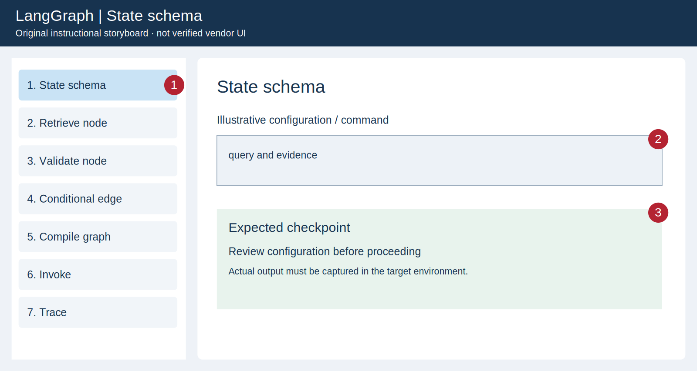
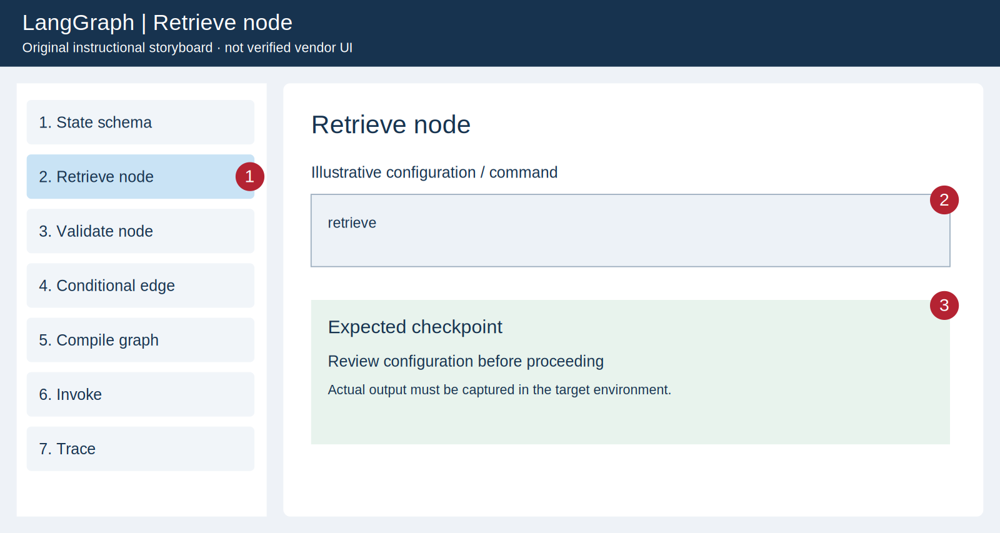
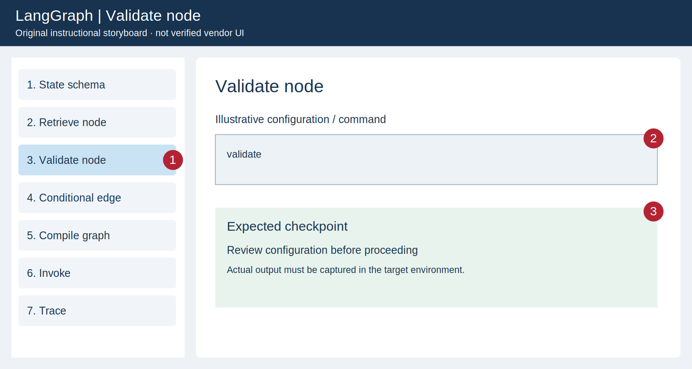
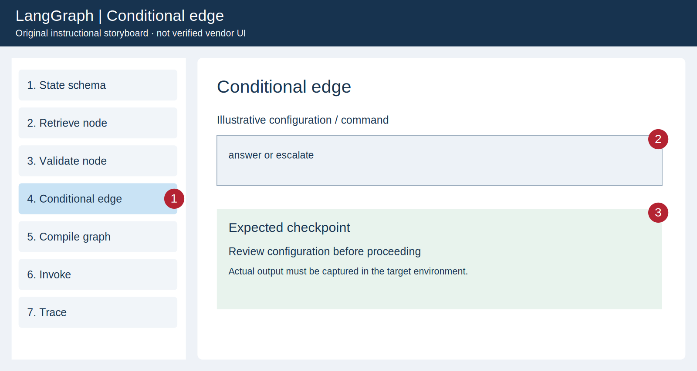
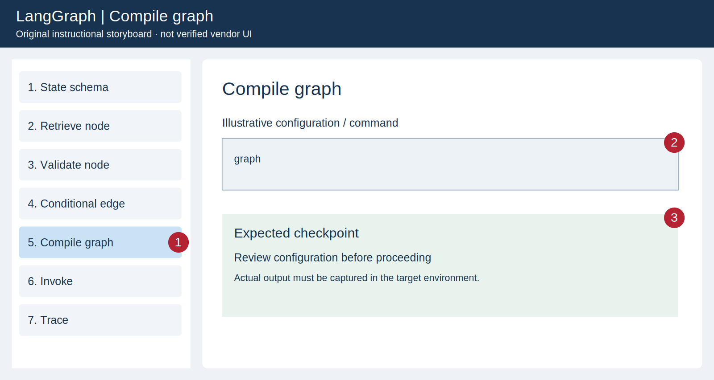
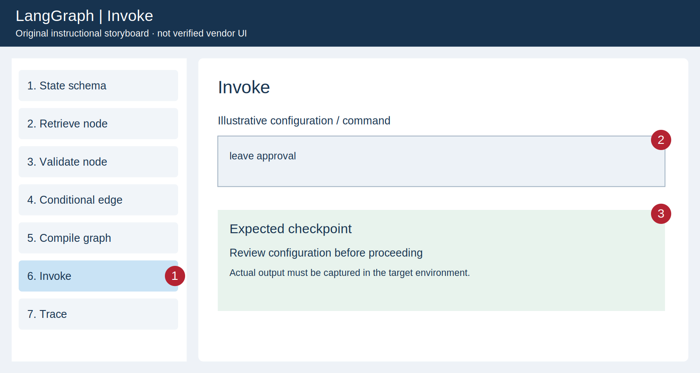
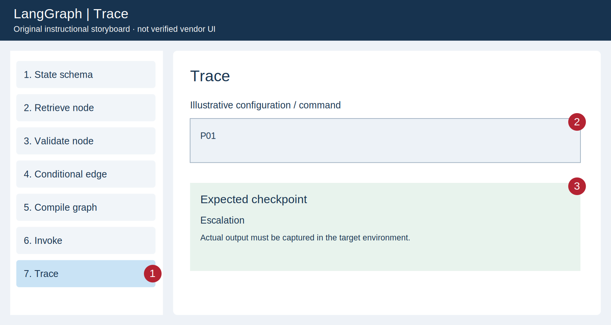

# LangGraph — numbered implementation walkthrough

Independent instructional storyboard. The navigation labels below are illustrative task stages, not verified vendor menu paths. No vendor deployment is claimed. Use synthetic data only. Prerequisites: browser for local illustrations; actual platform account, permissions and licensing must be established separately.

## Step 1: State schema
1. In the illustrated LangGraph workflow, locate callout 1 (State schema).
2. Inspect callout 2 and the sample value `query and evidence`.
3. Review the expected checkpoint at callout 3: configuration reviewed before continuing.
4. In the real environment, verify the equivalent control and capture actual output before proceeding.

## Step 2: Retrieve node
1. In the illustrated LangGraph workflow, locate callout 1 (Retrieve node).
2. Inspect callout 2 and the sample value `retrieve`.
3. Review the expected checkpoint at callout 3: configuration reviewed before continuing.
4. In the real environment, verify the equivalent control and capture actual output before proceeding.

## Step 3: Validate node
1. In the illustrated LangGraph workflow, locate callout 1 (Validate node).
2. Inspect callout 2 and the sample value `validate`.
3. Review the expected checkpoint at callout 3: configuration reviewed before continuing.
4. In the real environment, verify the equivalent control and capture actual output before proceeding.

## Step 4: Conditional edge
1. In the illustrated LangGraph workflow, locate callout 1 (Conditional edge).
2. Inspect callout 2 and the sample value `answer or escalate`.
3. Review the expected checkpoint at callout 3: configuration reviewed before continuing.
4. In the real environment, verify the equivalent control and capture actual output before proceeding.

## Step 5: Compile graph
1. In the illustrated LangGraph workflow, locate callout 1 (Compile graph).
2. Inspect callout 2 and the sample value `graph`.
3. Review the expected checkpoint at callout 3: configuration reviewed before continuing.
4. In the real environment, verify the equivalent control and capture actual output before proceeding.

## Step 6: Invoke
1. In the illustrated LangGraph workflow, locate callout 1 (Invoke).
2. Inspect callout 2 and the sample value `leave approval`.
3. Review the expected checkpoint at callout 3: configuration reviewed before continuing.
4. In the real environment, verify the equivalent control and capture actual output before proceeding.

## Step 7: Trace
1. In the illustrated LangGraph workflow, locate callout 1 (Trace).
2. Inspect callout 2 and the sample value `P01`.
3. Review the expected checkpoint at callout 3: Escalation.
4. In the real environment, verify the equivalent control and capture actual output before proceeding.

## Troubleshooting and executive acceptance
If a control is unavailable, verify role permissions, licensing and product version. If validation fails, stop, preserve the error and correct the input. Executive gate: Escalation. Record actual test output, reviewer and decision; do not claim completion without evidence.
