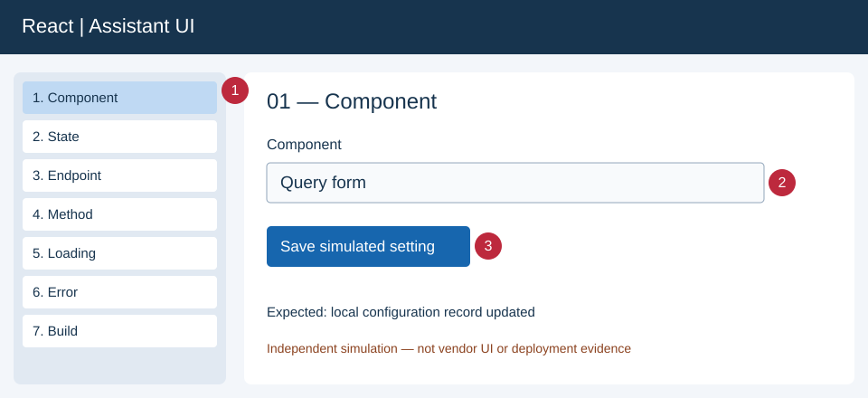
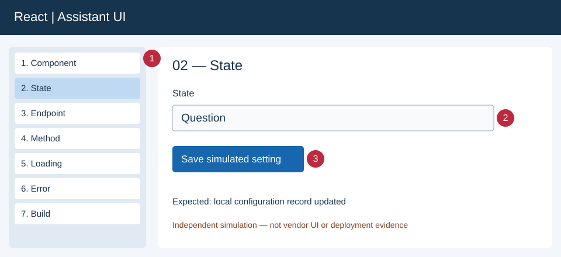
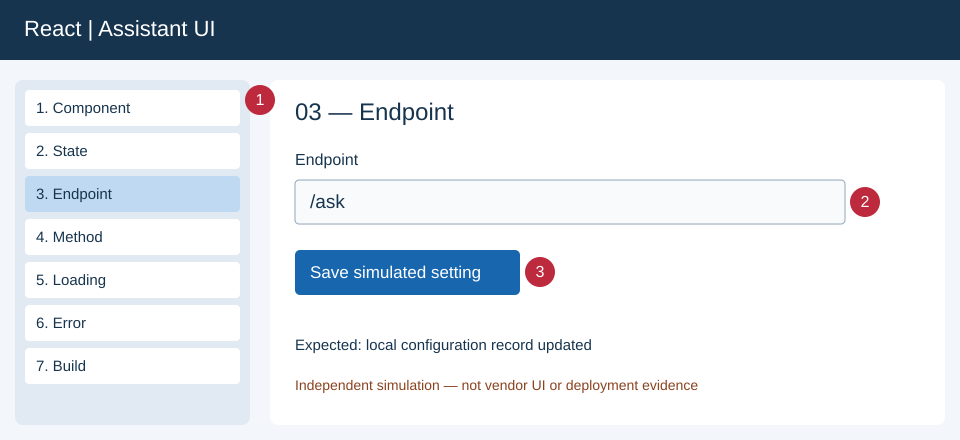
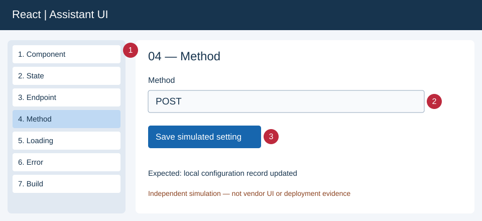
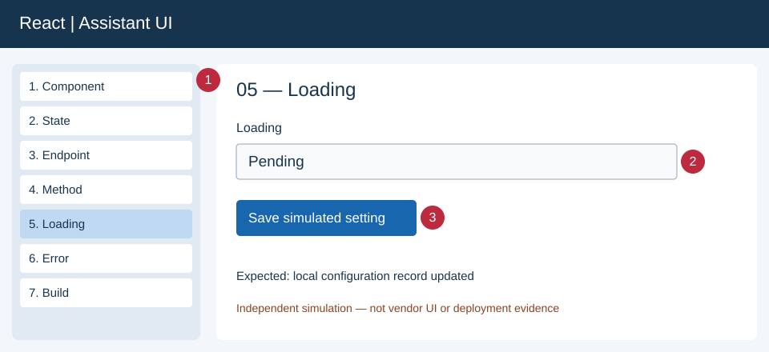
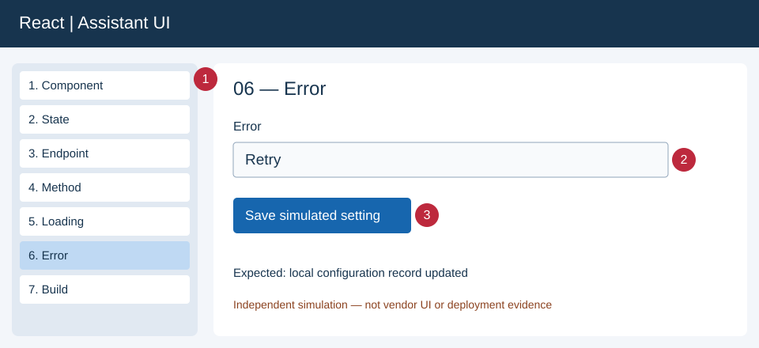
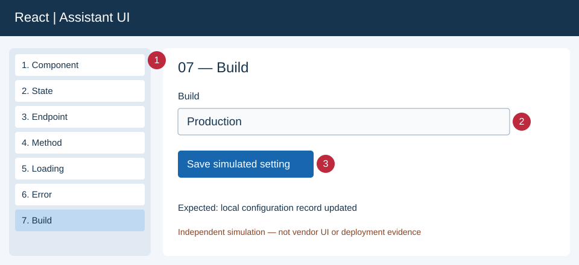

# React — Assistant UI

Original interactive configuration simulation. Download index.html and open locally in a browser. GitHub file preview does not execute HTML. This is not a replica of the vendor interface; settings are illustrative and must be verified in a real sandbox.

[Interactive HTML source](index.html)

## 01 — Component

Select **Component** in the simulation navigation, enter `Query form`, then select **Save simulated setting**. Confirm the configuration record contains the value before selecting Next step. This verifies local state only.

## 02 — State

Select **State** in the simulation navigation, enter `Question`, then select **Save simulated setting**. Confirm the configuration record contains the value before selecting Next step. This verifies local state only.

## 03 — Endpoint

Select **Endpoint** in the simulation navigation, enter `/ask`, then select **Save simulated setting**. Confirm the configuration record contains the value before selecting Next step. This verifies local state only.

## 04 — Method

Select **Method** in the simulation navigation, enter `POST`, then select **Save simulated setting**. Confirm the configuration record contains the value before selecting Next step. This verifies local state only.

## 05 — Loading

Select **Loading** in the simulation navigation, enter `Pending`, then select **Save simulated setting**. Confirm the configuration record contains the value before selecting Next step. This verifies local state only.

## 06 — Error

Select **Error** in the simulation navigation, enter `Retry`, then select **Save simulated setting**. Confirm the configuration record contains the value before selecting Next step. This verifies local state only.

## 07 — Build

Select **Build** in the simulation navigation, enter `Production`, then select **Save simulated setting**. Confirm the configuration record contains the value before selecting Next step. This verifies local state only.

