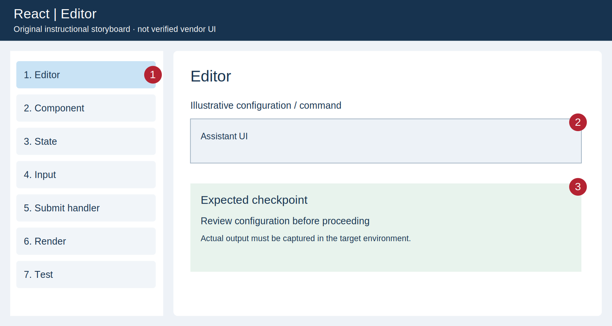
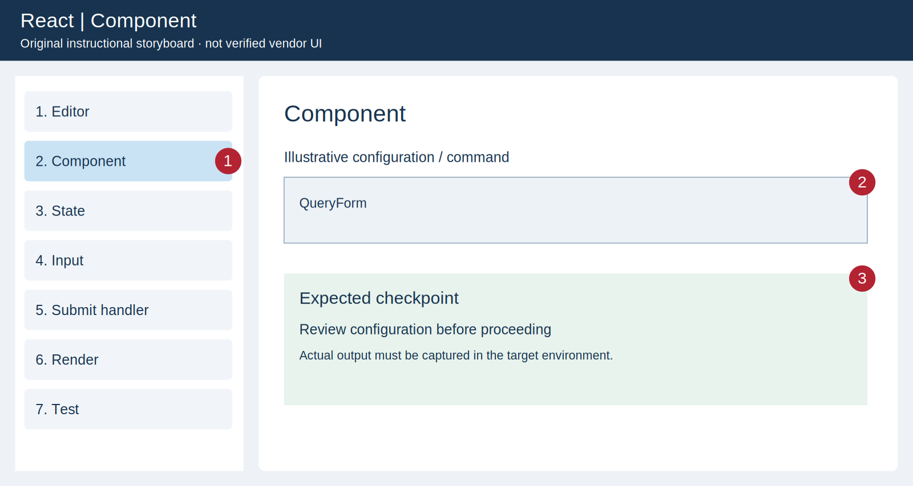
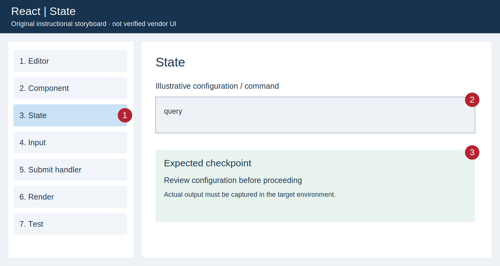
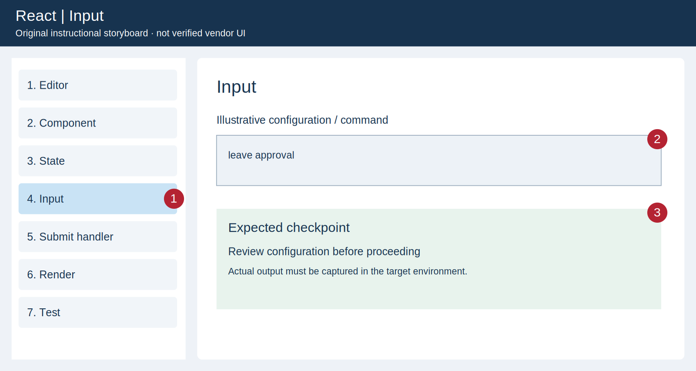
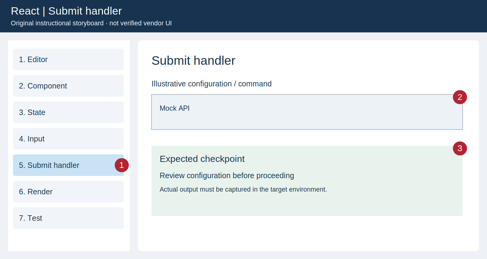
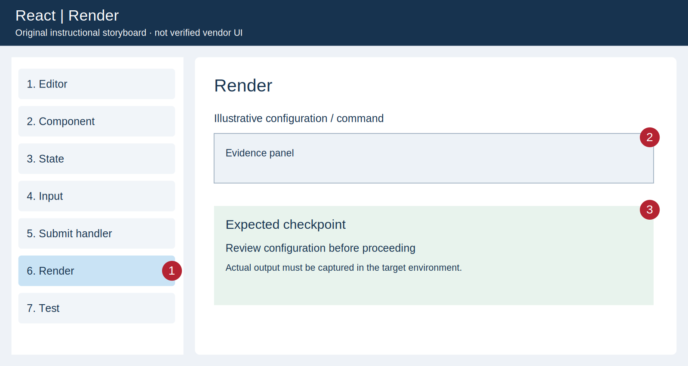
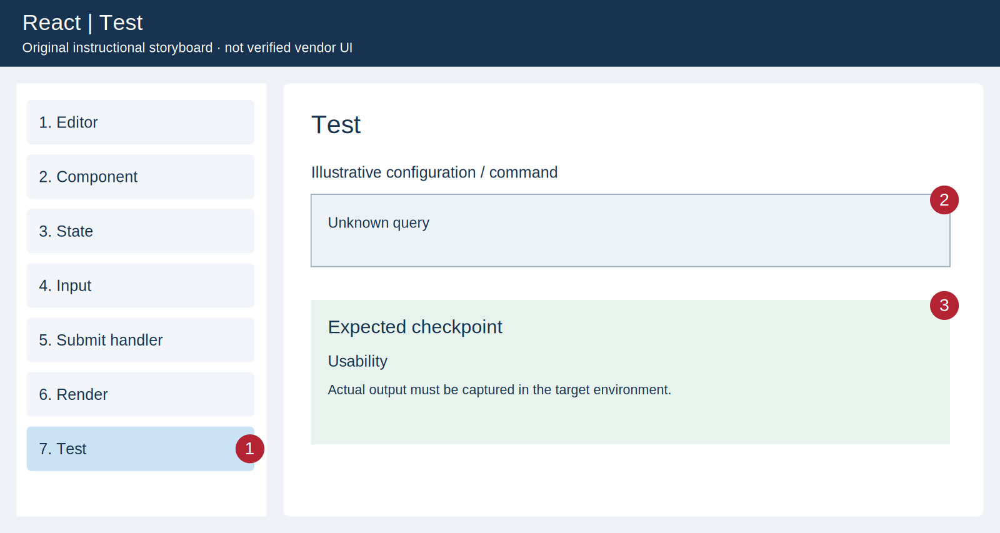

# React — numbered implementation walkthrough

Independent instructional storyboard. The navigation labels below are illustrative task stages, not verified vendor menu paths. No vendor deployment is claimed. Use synthetic data only. Prerequisites: browser for local illustrations; actual platform account, permissions and licensing must be established separately.

## Step 1: Editor
1. In the illustrated React workflow, locate callout 1 (Editor).
2. Inspect callout 2 and the sample value `Assistant UI`.
3. Review the expected checkpoint at callout 3: configuration reviewed before continuing.
4. In the real environment, verify the equivalent control and capture actual output before proceeding.

## Step 2: Component
1. In the illustrated React workflow, locate callout 1 (Component).
2. Inspect callout 2 and the sample value `QueryForm`.
3. Review the expected checkpoint at callout 3: configuration reviewed before continuing.
4. In the real environment, verify the equivalent control and capture actual output before proceeding.

## Step 3: State
1. In the illustrated React workflow, locate callout 1 (State).
2. Inspect callout 2 and the sample value `query`.
3. Review the expected checkpoint at callout 3: configuration reviewed before continuing.
4. In the real environment, verify the equivalent control and capture actual output before proceeding.

## Step 4: Input
1. In the illustrated React workflow, locate callout 1 (Input).
2. Inspect callout 2 and the sample value `leave approval`.
3. Review the expected checkpoint at callout 3: configuration reviewed before continuing.
4. In the real environment, verify the equivalent control and capture actual output before proceeding.

## Step 5: Submit handler
1. In the illustrated React workflow, locate callout 1 (Submit handler).
2. Inspect callout 2 and the sample value `Mock API`.
3. Review the expected checkpoint at callout 3: configuration reviewed before continuing.
4. In the real environment, verify the equivalent control and capture actual output before proceeding.

## Step 6: Render
1. In the illustrated React workflow, locate callout 1 (Render).
2. Inspect callout 2 and the sample value `Evidence panel`.
3. Review the expected checkpoint at callout 3: configuration reviewed before continuing.
4. In the real environment, verify the equivalent control and capture actual output before proceeding.

## Step 7: Test
1. In the illustrated React workflow, locate callout 1 (Test).
2. Inspect callout 2 and the sample value `Unknown query`.
3. Review the expected checkpoint at callout 3: Usability.
4. In the real environment, verify the equivalent control and capture actual output before proceeding.

## Troubleshooting and executive acceptance
If a control is unavailable, verify role permissions, licensing and product version. If validation fails, stop, preserve the error and correct the input. Executive gate: Usability. Record actual test output, reviewer and decision; do not claim completion without evidence.
