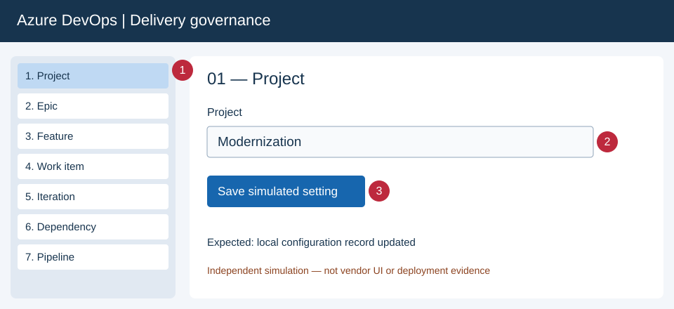
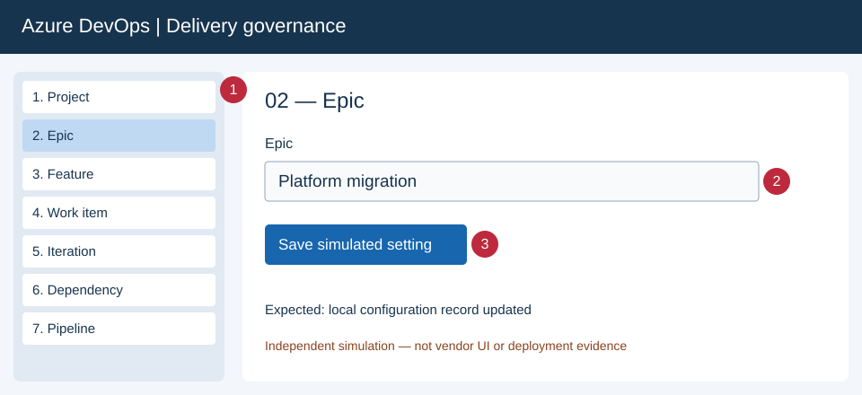
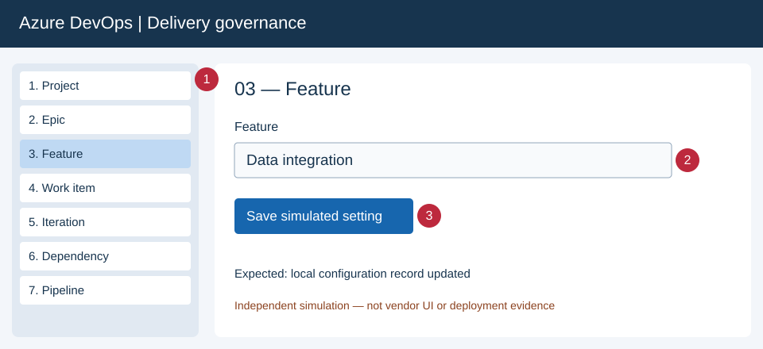
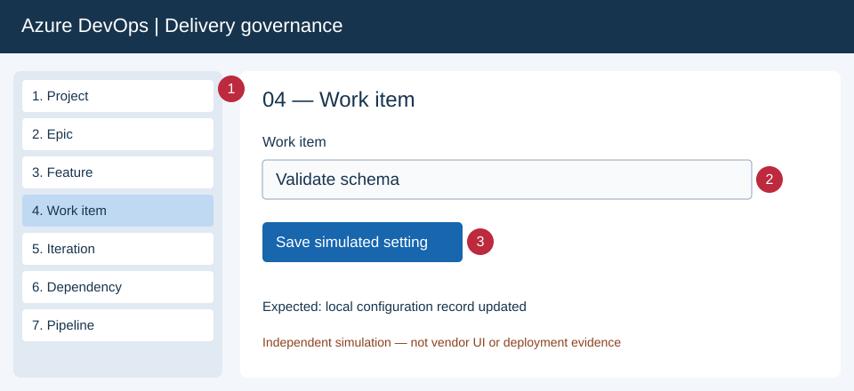
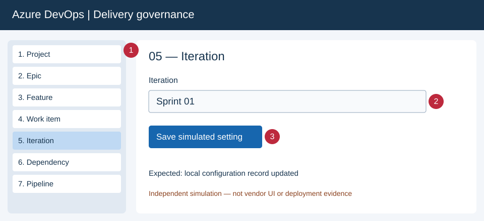
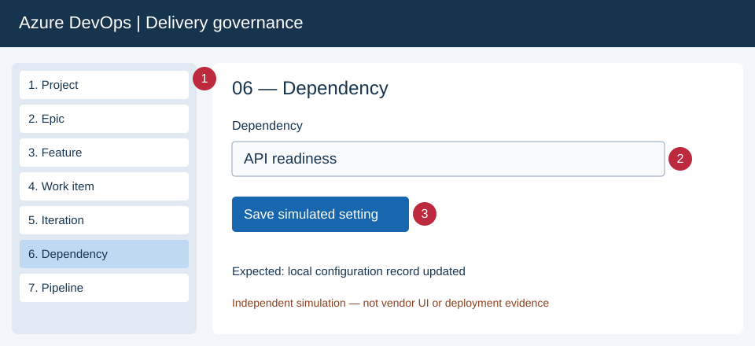
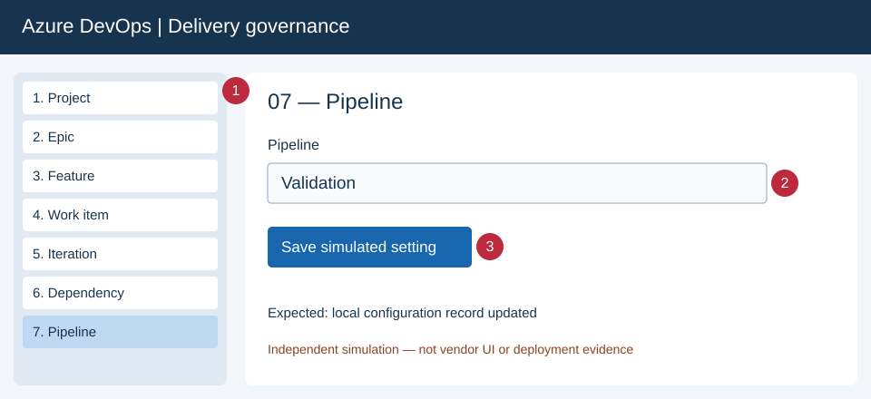

# Azure DevOps — Delivery governance

Original interactive configuration simulation. Download index.html and open locally in a browser. GitHub file preview does not execute HTML. This is not a replica of the vendor interface; settings are illustrative and must be verified in a real sandbox.

[Interactive HTML source](index.html)

## 01 — Project

Select **Project** in the simulation navigation, enter `Modernization`, then select **Save simulated setting**. Confirm the configuration record contains the value before selecting Next step. This verifies local state only.

## 02 — Epic

Select **Epic** in the simulation navigation, enter `Platform migration`, then select **Save simulated setting**. Confirm the configuration record contains the value before selecting Next step. This verifies local state only.

## 03 — Feature

Select **Feature** in the simulation navigation, enter `Data integration`, then select **Save simulated setting**. Confirm the configuration record contains the value before selecting Next step. This verifies local state only.

## 04 — Work item

Select **Work item** in the simulation navigation, enter `Validate schema`, then select **Save simulated setting**. Confirm the configuration record contains the value before selecting Next step. This verifies local state only.

## 05 — Iteration

Select **Iteration** in the simulation navigation, enter `Sprint 01`, then select **Save simulated setting**. Confirm the configuration record contains the value before selecting Next step. This verifies local state only.

## 06 — Dependency

Select **Dependency** in the simulation navigation, enter `API readiness`, then select **Save simulated setting**. Confirm the configuration record contains the value before selecting Next step. This verifies local state only.

## 07 — Pipeline

Select **Pipeline** in the simulation navigation, enter `Validation`, then select **Save simulated setting**. Confirm the configuration record contains the value before selecting Next step. This verifies local state only.

