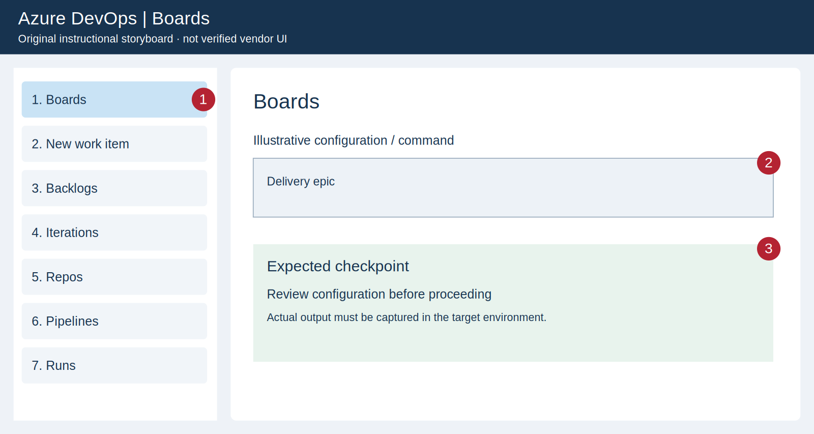
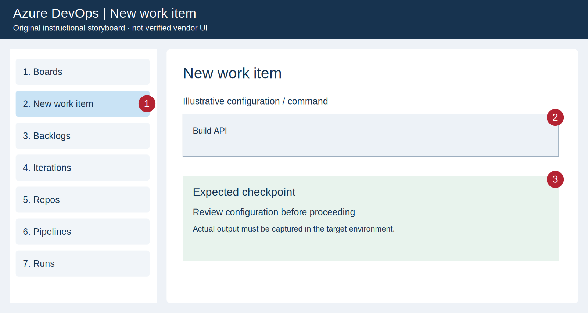
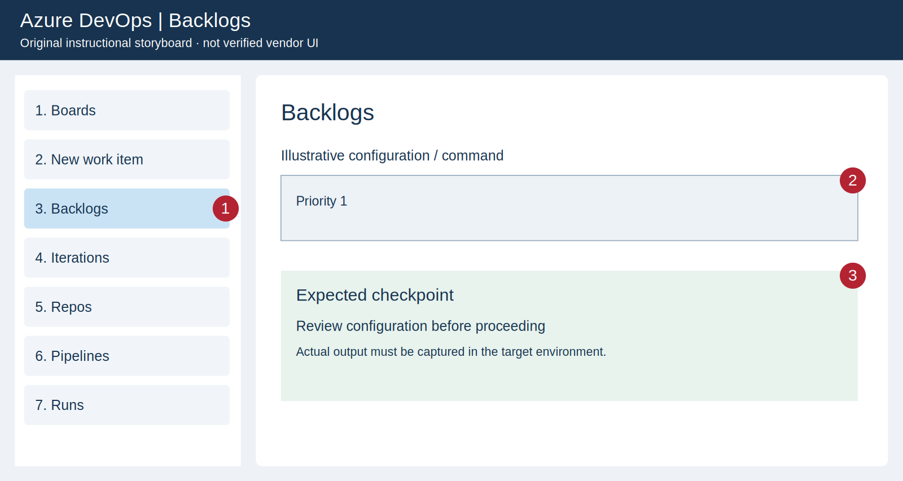
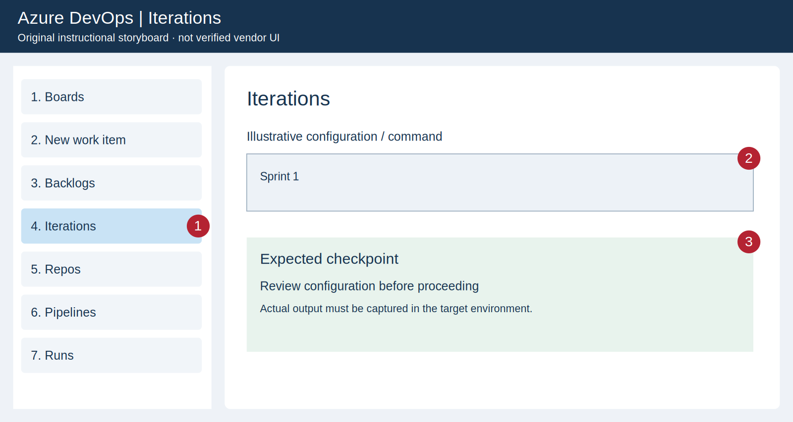
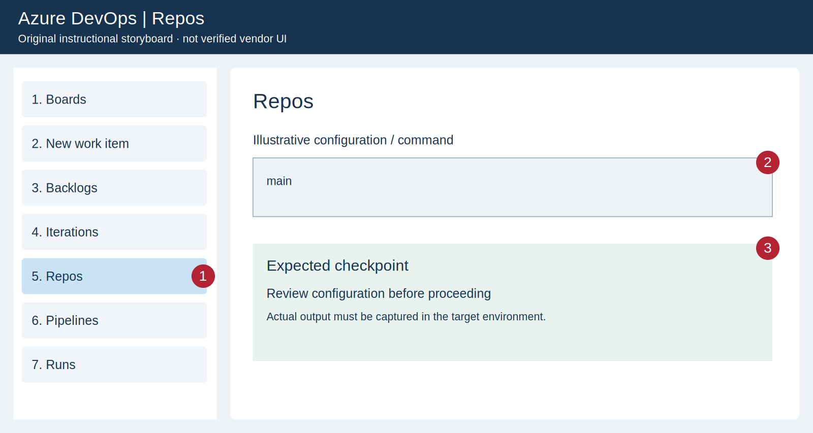
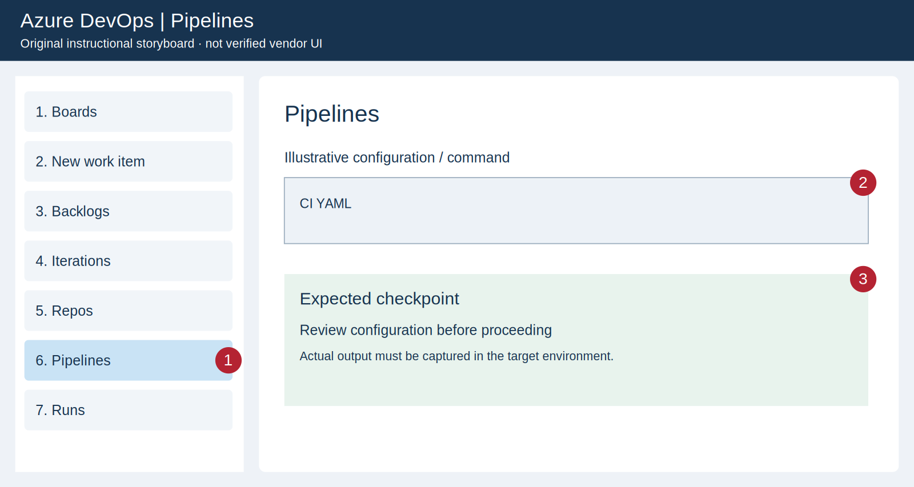
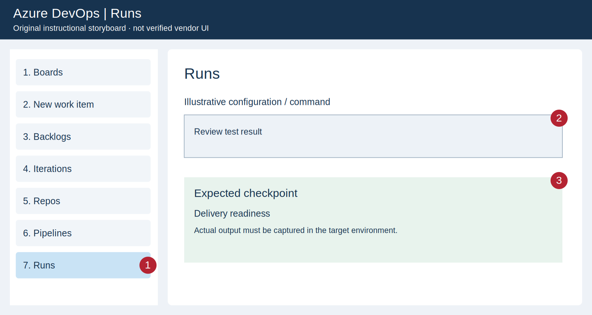

# Azure DevOps — numbered implementation walkthrough

Independent instructional storyboard. The navigation labels below are illustrative task stages, not verified vendor menu paths. No vendor deployment is claimed. Use synthetic data only. Prerequisites: browser for local illustrations; actual platform account, permissions and licensing must be established separately.

## Step 1: Boards
1. In the illustrated Azure DevOps workflow, locate callout 1 (Boards).
2. Inspect callout 2 and the sample value `Delivery epic`.
3. Review the expected checkpoint at callout 3: configuration reviewed before continuing.
4. In the real environment, verify the equivalent control and capture actual output before proceeding.

## Step 2: New work item
1. In the illustrated Azure DevOps workflow, locate callout 1 (New work item).
2. Inspect callout 2 and the sample value `Build API`.
3. Review the expected checkpoint at callout 3: configuration reviewed before continuing.
4. In the real environment, verify the equivalent control and capture actual output before proceeding.

## Step 3: Backlogs
1. In the illustrated Azure DevOps workflow, locate callout 1 (Backlogs).
2. Inspect callout 2 and the sample value `Priority 1`.
3. Review the expected checkpoint at callout 3: configuration reviewed before continuing.
4. In the real environment, verify the equivalent control and capture actual output before proceeding.

## Step 4: Iterations
1. In the illustrated Azure DevOps workflow, locate callout 1 (Iterations).
2. Inspect callout 2 and the sample value `Sprint 1`.
3. Review the expected checkpoint at callout 3: configuration reviewed before continuing.
4. In the real environment, verify the equivalent control and capture actual output before proceeding.

## Step 5: Repos
1. In the illustrated Azure DevOps workflow, locate callout 1 (Repos).
2. Inspect callout 2 and the sample value `main`.
3. Review the expected checkpoint at callout 3: configuration reviewed before continuing.
4. In the real environment, verify the equivalent control and capture actual output before proceeding.

## Step 6: Pipelines
1. In the illustrated Azure DevOps workflow, locate callout 1 (Pipelines).
2. Inspect callout 2 and the sample value `CI YAML`.
3. Review the expected checkpoint at callout 3: configuration reviewed before continuing.
4. In the real environment, verify the equivalent control and capture actual output before proceeding.

## Step 7: Runs
1. In the illustrated Azure DevOps workflow, locate callout 1 (Runs).
2. Inspect callout 2 and the sample value `Review test result`.
3. Review the expected checkpoint at callout 3: Delivery readiness.
4. In the real environment, verify the equivalent control and capture actual output before proceeding.

## Troubleshooting and executive acceptance
If a control is unavailable, verify role permissions, licensing and product version. If validation fails, stop, preserve the error and correct the input. Executive gate: Delivery readiness. Record actual test output, reviewer and decision; do not claim completion without evidence.
