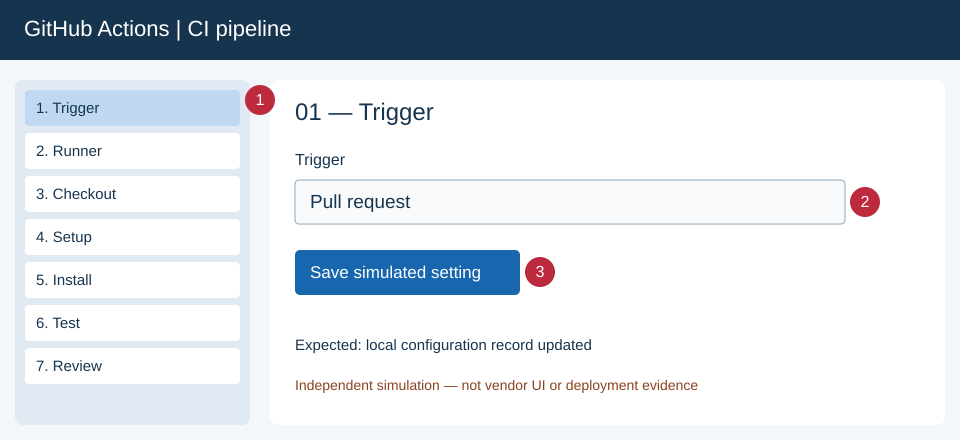
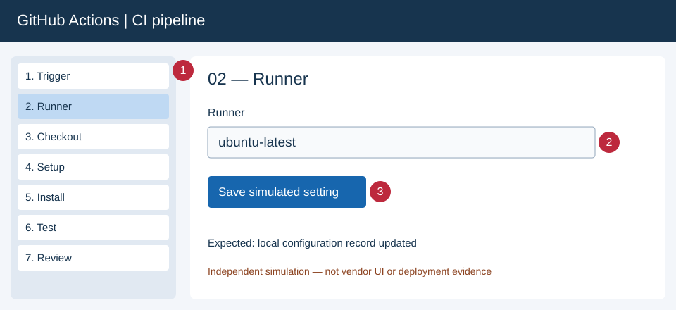
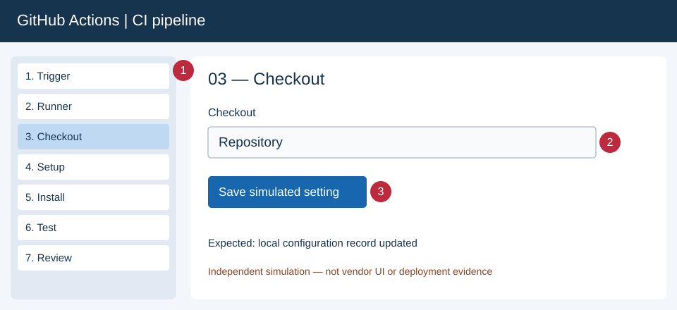
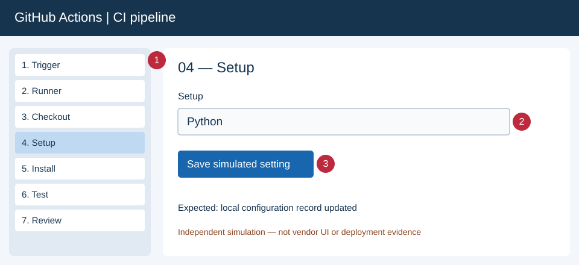
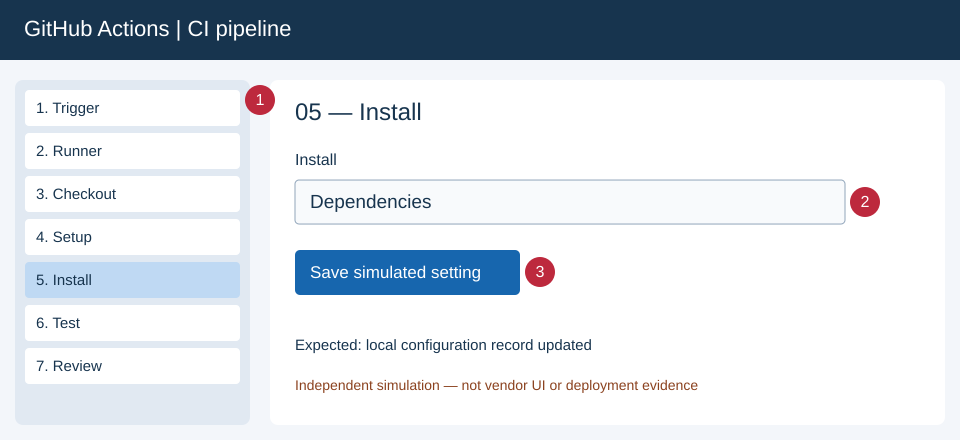
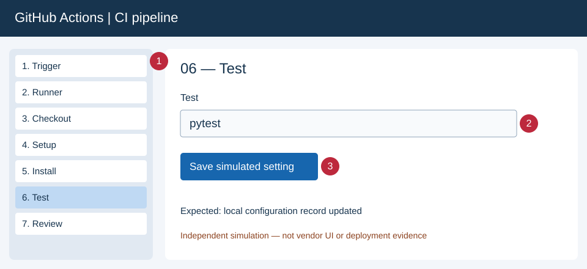
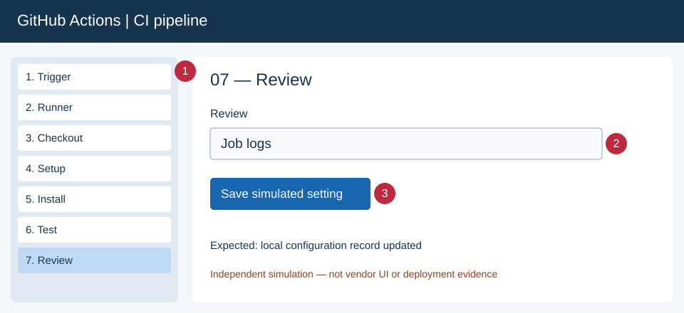

# GitHub Actions — CI pipeline

Original interactive configuration simulation. Download index.html and open locally in a browser. GitHub file preview does not execute HTML. This is not a replica of the vendor interface; settings are illustrative and must be verified in a real sandbox.

[Interactive HTML source](index.html)

## 01 — Trigger

Select **Trigger** in the simulation navigation, enter `Pull request`, then select **Save simulated setting**. Confirm the configuration record contains the value before selecting Next step. This verifies local state only.

## 02 — Runner

Select **Runner** in the simulation navigation, enter `ubuntu-latest`, then select **Save simulated setting**. Confirm the configuration record contains the value before selecting Next step. This verifies local state only.

## 03 — Checkout

Select **Checkout** in the simulation navigation, enter `Repository`, then select **Save simulated setting**. Confirm the configuration record contains the value before selecting Next step. This verifies local state only.

## 04 — Setup

Select **Setup** in the simulation navigation, enter `Python`, then select **Save simulated setting**. Confirm the configuration record contains the value before selecting Next step. This verifies local state only.

## 05 — Install

Select **Install** in the simulation navigation, enter `Dependencies`, then select **Save simulated setting**. Confirm the configuration record contains the value before selecting Next step. This verifies local state only.

## 06 — Test

Select **Test** in the simulation navigation, enter `pytest`, then select **Save simulated setting**. Confirm the configuration record contains the value before selecting Next step. This verifies local state only.

## 07 — Review

Select **Review** in the simulation navigation, enter `Job logs`, then select **Save simulated setting**. Confirm the configuration record contains the value before selecting Next step. This verifies local state only.

