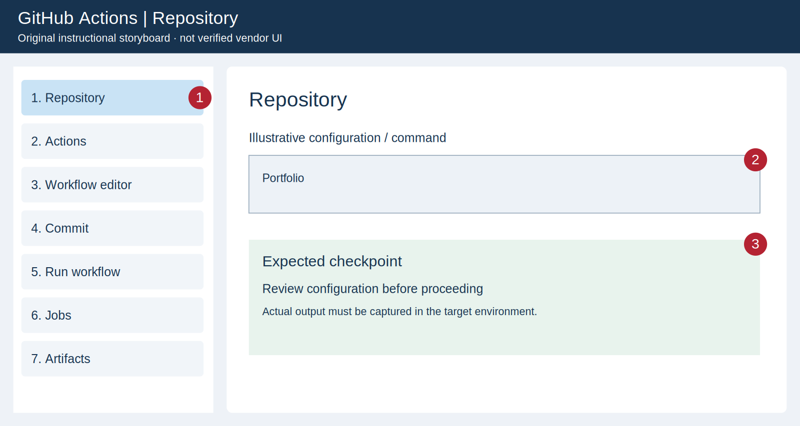
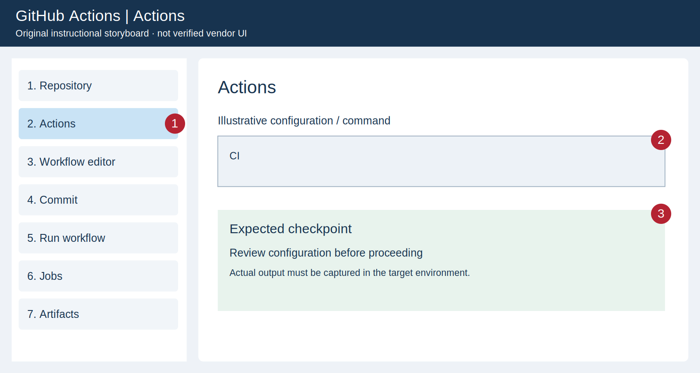
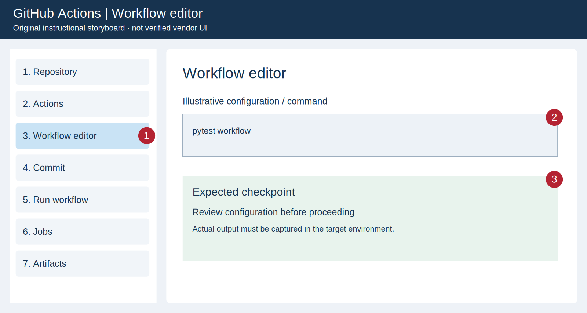
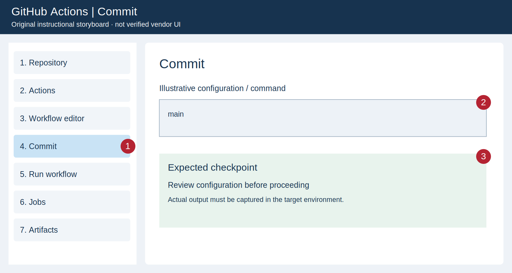
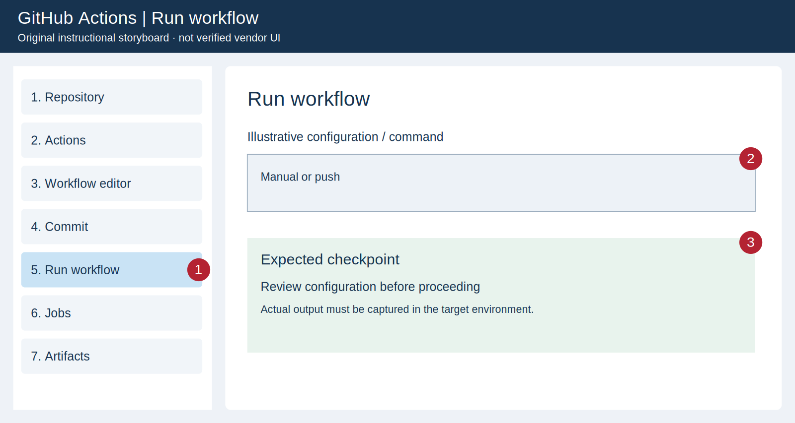
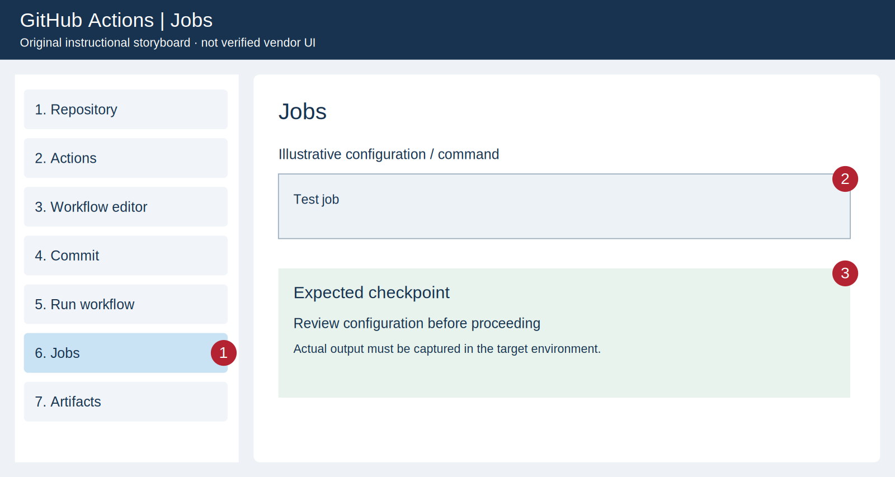
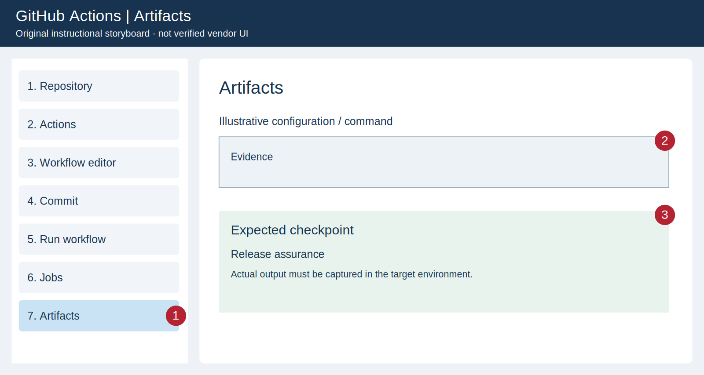

# GitHub Actions — numbered implementation walkthrough

Independent instructional storyboard. The navigation labels below are illustrative task stages, not verified vendor menu paths. No vendor deployment is claimed. Use synthetic data only. Prerequisites: browser for local illustrations; actual platform account, permissions and licensing must be established separately.

## Step 1: Repository
1. In the illustrated GitHub Actions workflow, locate callout 1 (Repository).
2. Inspect callout 2 and the sample value `Portfolio`.
3. Review the expected checkpoint at callout 3: configuration reviewed before continuing.
4. In the real environment, verify the equivalent control and capture actual output before proceeding.

## Step 2: Actions
1. In the illustrated GitHub Actions workflow, locate callout 1 (Actions).
2. Inspect callout 2 and the sample value `CI`.
3. Review the expected checkpoint at callout 3: configuration reviewed before continuing.
4. In the real environment, verify the equivalent control and capture actual output before proceeding.

## Step 3: Workflow editor
1. In the illustrated GitHub Actions workflow, locate callout 1 (Workflow editor).
2. Inspect callout 2 and the sample value `pytest workflow`.
3. Review the expected checkpoint at callout 3: configuration reviewed before continuing.
4. In the real environment, verify the equivalent control and capture actual output before proceeding.

## Step 4: Commit
1. In the illustrated GitHub Actions workflow, locate callout 1 (Commit).
2. Inspect callout 2 and the sample value `main`.
3. Review the expected checkpoint at callout 3: configuration reviewed before continuing.
4. In the real environment, verify the equivalent control and capture actual output before proceeding.

## Step 5: Run workflow
1. In the illustrated GitHub Actions workflow, locate callout 1 (Run workflow).
2. Inspect callout 2 and the sample value `Manual or push`.
3. Review the expected checkpoint at callout 3: configuration reviewed before continuing.
4. In the real environment, verify the equivalent control and capture actual output before proceeding.

## Step 6: Jobs
1. In the illustrated GitHub Actions workflow, locate callout 1 (Jobs).
2. Inspect callout 2 and the sample value `Test job`.
3. Review the expected checkpoint at callout 3: configuration reviewed before continuing.
4. In the real environment, verify the equivalent control and capture actual output before proceeding.

## Step 7: Artifacts
1. In the illustrated GitHub Actions workflow, locate callout 1 (Artifacts).
2. Inspect callout 2 and the sample value `Evidence`.
3. Review the expected checkpoint at callout 3: Release assurance.
4. In the real environment, verify the equivalent control and capture actual output before proceeding.

## Troubleshooting and executive acceptance
If a control is unavailable, verify role permissions, licensing and product version. If validation fails, stop, preserve the error and correct the input. Executive gate: Release assurance. Record actual test output, reviewer and decision; do not claim completion without evidence.
